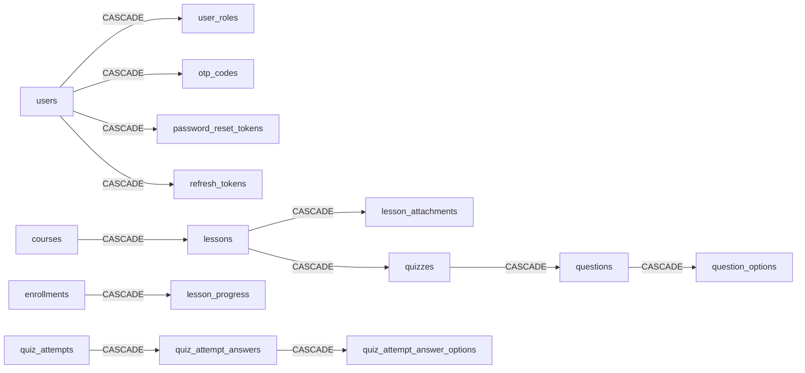

# 03 — Ràng buộc & chỉ mục

## 1. Khóa ngoại và hành vi khi xóa

SQL Server **không cho phép** khai báo khóa ngoại tạo ra vòng lặp hoặc nhiều đường cascade tới cùng một bảng (lỗi 1785: *"may cause cycles or multiple cascade paths"*). Vì vậy `ON DELETE CASCADE` chỉ dùng cho quan hệ **cha – con sở hữu** rõ ràng. Mọi quan hệ còn lại dùng `NO ACTION` (mặc định), và đây cũng là cơ chế chặn xóa dữ liệu đã phát sinh lịch sử.

| # | Bảng con | Cột | Tham chiếu | ON DELETE | Lý do |
|---|----------|-----|------------|-----------|-------|
| 1 | user_roles | user_id | users | **CASCADE** | Xóa cứng user chưa xác thực (BR-AUTH-06) thì xóa luôn phần gán vai trò |
| 2 | user_roles | role_id | roles | NO ACTION | Không xóa vai trò đang được dùng |
| 3 | otp_codes | user_id | users | **CASCADE** | Như #1 |
| 4 | password_reset_tokens | user_id | users | **CASCADE** | Như #1 |
| 5 | refresh_tokens | user_id | users | **CASCADE** | Như #1 |
| 6 | refresh_tokens | replaced_by_id | refresh_tokens | NO ACTION | Tự tham chiếu, SQL Server không cho cascade |
| 7 | uploaded_files | uploaded_by | users | NO ACTION | |
| 8 | course_categories | (parent_id, parent_depth) | course_categories (id, depth) | NO ACTION | BR-ADM-04: không xóa loại cấp 1 còn loại con |
| 9 | courses | (category_id, category_depth) | course_categories (id, depth) | NO ACTION | BR-ADM-04: không xóa loại cấp 2 còn khóa học |
| 10 | courses | organization_id | organizations | NO ACTION | Không xóa tổ chức còn khóa học |
| 11 | courses | created_by / updated_by | users | NO ACTION | |
| 12 | lessons | course_id | courses | **CASCADE** | BR-ADM-08: xóa khóa `DRAFT` chưa có học viên thì xóa luôn bài học |
| 13 | lesson_attachments | lesson_id | lessons | **CASCADE** | |
| 14 | lesson_attachments | file_id | uploaded_files | NO ACTION | |
| 15 | quizzes | lesson_id | lessons | **CASCADE** | |
| 16 | questions | quiz_id | quizzes | **CASCADE** | |
| 17 | question_options | question_id | questions | **CASCADE** | |
| 18 | enrollments | user_id | users | NO ACTION | User chỉ bị xóa mềm |
| 19 | enrollments | course_id | courses | NO ACTION | BR-ADM-07: khóa học có học viên không xóa được |
| 20 | enrollments | last_lesson_id | lessons | NO ACTION | |
| 21 | lesson_progress | enrollment_id | enrollments | **CASCADE** | |
| 22 | lesson_progress | lesson_id | lessons | NO ACTION | Bài học đã có người học không xóa được, chỉ ẩn (`is_published = 0`) |
| 23 | quiz_attempts | quiz_id / user_id / enrollment_id | quizzes / users / enrollments | NO ACTION | Giữ lịch sử làm bài |
| 24 | quiz_attempt_answers | attempt_id | quiz_attempts | **CASCADE** | |
| 25 | quiz_attempt_answers | question_id | questions | NO ACTION | Câu hỏi đã có người trả lời chỉ được tắt (`is_active = 0`) |
| 26 | quiz_attempt_answer_options | answer_id | quiz_attempt_answers | **CASCADE** | |
| 27 | quiz_attempt_answer_options | option_id | question_options | NO ACTION | Như #25 |
| 28 | quiz_best_attempts | user_id / quiz_id / course_id / attempt_id | ... | NO ACTION | |
| 29 | rankings | user_id / course_id | users / courses | NO ACTION | |
| 30 | course_reviews | course_id / user_id / hidden_by | courses / users / users | NO ACTION | |
| 31 | audit_logs | actor_id | users | NO ACTION | |

### 1.1 Các đường cascade (đã kiểm tra không trùng lặp)



Mỗi bảng con chỉ nhận cascade từ **đúng một** bảng cha, nên SQL Server chấp nhận toàn bộ khai báo.

### 1.2 Hệ quả: các thao tác xóa được phép

| Thao tác | Kết quả |
|----------|---------|
| Job xóa user `PENDING_VERIFICATION` quá 7 ngày | ✔ Thành công. User loại này không có ghi danh, khóa học hay audit log |
| Xóa user đã hoạt động | ✘ Bị FK chặn. Ứng dụng dùng **xóa mềm** (`deleted_at`) |
| Xóa khóa học `DRAFT` chưa có học viên | ✔ Xóa dây chuyền: bài học → quiz → câu hỏi → đáp án, tệp đính kèm |
| Xóa khóa học đã có ghi danh | ✘ Bị FK `fk_enrollments_course` chặn. Chỉ được `ARCHIVED` |
| Xóa bài học đã có người mở | ✘ Bị `fk_lesson_progress_lesson` chặn. Chỉ được ẩn |
| Xóa câu hỏi/đáp án đã có người trả lời | ✘ Bị FK chặn. Đặt `is_active = 0` |
| Xóa loại khóa học còn con hoặc còn khóa học | ✘ Bị FK chặn (BR-ADM-04). Ứng dụng kiểm tra trước để báo lỗi `409` thân thiện |

> Ứng dụng nên **kiểm tra điều kiện trước** và trả mã lỗi nghiệp vụ (`CATEGORY_HAS_CHILDREN`, `COURSE_HAS_ENROLLMENTS`...). FK chỉ là lớp bảo vệ cuối cùng.

## 2. Ràng buộc CHECK theo quy tắc nghiệp vụ

| Constraint | Quy tắc | Truy vết |
|------------|---------|----------|
| `ck_users_status` | Trạng thái tài khoản hợp lệ | FR-AUTH-10 |
| `ck_users_birth_year` | 1900 ≤ năm sinh ≤ năm hiện tại | FR-AUTH-01 |
| `ck_otp_codes_failed_attempts` | Tối đa 5 lần nhập sai | BR-AUTH-03 |
| `ck_course_categories_depth` | Cấp 1 không có cha. Cấp 2 có cha và cha là cấp 1 | BR-ADM-02 |
| `ck_courses_category_depth` | Khóa học chỉ gắn loại cấp 2 | BR-ADM-03 |
| `ck_courses_dates` | `end_date > start_date` | FR-ADM-13 |
| `ck_courses_published_at` | Đã xuất bản thì phải có `published_at` | FR-ADM-14 |
| `ck_courses_certificate_criteria` | JSON hợp lệ | FR-CRS-08 |
| `ck_quizzes_pass_score_percent` | 0..100 | FR-ADM-17 |
| `ck_questions_type` | 3 loại câu hỏi | A-04 |
| `ck_enrollments_completed_at` / `_cancelled_at` | Trạng thái đi kèm mốc thời gian | FR-LRN-11, FR-CRS-11 |
| `ck_lesson_progress_completion` | Đã hoàn thành thì phải có thời điểm và cách hoàn thành | BR-LRN-01 |
| `ck_quiz_attempts_result` | Lượt đã nộp phải có đủ điểm, thời gian, kết quả. `0 ≤ score ≤ max_score` | BR-LRN-03 |
| `ck_course_reviews_rating` | 1..5 sao | FR-CRS-07 |
| `ck_course_reviews_hidden` | Ẩn đánh giá phải ghi nhận người ẩn và thời điểm | FR-ADM-20 |

### 2.1 Quy tắc không thể/không nên kiểm tra bằng CHECK (ứng dụng chịu trách nhiệm)

| Quy tắc | Lý do để ở tầng service |
|---------|-------------------------|
| Số đáp án đúng theo loại câu hỏi | Ràng buộc nhiều dòng |
| Điều kiện xuất bản khóa học (BR-ADM-06) | Phụ thuộc nhiều bảng |
| Mở khóa bài học tuần tự (BR-LRN-02) | Logic truy vấn ([05](05-truy-van-nghiep-vu.md) §2) |
| Giới hạn `max_attempts`, `retry_cooldown_seconds` | Kiểm tra khi bắt đầu lượt mới, trong transaction |
| Luôn còn ít nhất 1 Admin (BR-AUTH-07) | Ràng buộc nhiều dòng |
| Chỉ người đã hoàn thành ≥ 1 bài mới được đánh giá (BR-CRS-03) | Phụ thuộc nhiều bảng |

## 3. Kỹ thuật ràng buộc 2 cấp cho loại khóa học

Không dùng trigger. Ràng buộc được khai báo bằng **khóa ngoại tổ hợp kèm cột "cấp"**:

```
course_categories:  UNIQUE (id, depth)
  ├─ con trỏ lên cha:  FK (parent_id, parent_depth) → (id, depth),  CHECK parent_depth = 1
  └─ courses trỏ tới:  FK (category_id, category_depth) → (id, depth), CHECK category_depth = 2
```

| Tình huống | Kết quả |
|------------|---------|
| Tạo loại con của một loại cấp 2 (tạo cấp 3) | ✘ `parent_depth` phải là 1, nhưng (id cha, 1) không tồn tại vì cha có depth = 2 |
| Gắn khóa học vào loại cấp 1 | ✘ (category_id, 2) không tồn tại |
| Chuyển loại cấp 1 đang có con thành cấp 2 | ✘ Đổi `depth` thì các FK con đang trỏ tới (id, 1) bị vi phạm |
| Chuyển loại cấp 2 đang có khóa học thành cấp 1 | ✘ FK của `courses` đang trỏ tới (id, 2) bị vi phạm |

**Ghi chú ánh xạ JPA:** `parent_depth` và `category_depth` là cột kỹ thuật. Có thể ánh xạ bằng `@Column(insertable = true, updatable = false)` và gán giá trị cố định trong entity, hoặc không ánh xạ `category_depth` để DB tự dùng giá trị mặc định 2.

## 4. Chỉ mục

### 4.1 Nguyên tắc

- Mọi khóa ngoại đều có chỉ mục (SQL Server **không** tự tạo, khác với PRIMARY KEY/UNIQUE).
- Chỉ mục phục vụ các truy vấn chính trong [05](05-truy-van-nghiep-vu.md). Dùng `INCLUDE` để tránh key lookup trên các trang danh sách.
- Dùng **filtered index** cho tập con hay truy vấn (`WHERE deleted_at IS NULL`, `WHERE status = N'IN_PROGRESS'`, `WHERE is_featured = 1`).
- Khóa clustered là `id` tăng dần cho mọi bảng có identity, giúp tránh phân mảnh khi ghi.

### 4.2 Danh sách chỉ mục (ngoài PK/UNIQUE)

| Chỉ mục | Bảng | Khóa (INCLUDE) | Phục vụ |
|---------|------|----------------|---------|
| `ux_users_email` *(unique, filtered `deleted_at IS NULL`)* | users | email | Đăng nhập, kiểm tra trùng email |
| `ix_users_status_created_at` *(filtered)* | users | status, created_at | Admin lọc người dùng, job dọn tài khoản chưa xác thực, dashboard |
| `ix_user_roles_role` | user_roles | role_id | Loại Admin khỏi xếp hạng, đếm Admin |
| `ix_otp_codes_user_purpose` | otp_codes | user_id, purpose, created_at DESC | Lấy OTP mới nhất, đếm lượt gửi/giờ |
| `ix_otp_codes_expires_at` | otp_codes | expires_at | Job dọn dẹp |
| `ix_refresh_tokens_user_active` *(filtered `revoked_at IS NULL`)* | refresh_tokens | user_id | Thu hồi mọi phiên của user |
| `ix_refresh_tokens_expires_at` | refresh_tokens | expires_at | Job dọn dẹp |
| `ix_course_categories_parent` | course_categories | parent_id, sort_order | Dựng cây loại khóa học |
| `ix_courses_status_category` | courses | publish_status, category_id (course_level, organization_id, start_date, end_date, published_at, enrollment_count, rating_avg) | Tìm kiếm lọc theo lĩnh vực |
| `ix_courses_status_organization` | courses | publish_status, organization_id (...) | Lọc theo tổ chức đào tạo |
| `ix_courses_status_published_at` | courses | publish_status, published_at DESC | Sắp xếp "Mới nhất" |
| `ix_courses_status_popular` | courses | publish_status, enrollment_count DESC | Sắp xếp "Nhiều người học nhất" |
| `ix_courses_featured` *(filtered `is_featured = 1`)* | courses | publish_status, published_at DESC | Trang chủ |
| `ix_questions_quiz` | questions | quiz_id, is_active, order_index | Lấy đề quiz |
| `ix_question_options_question` | question_options | question_id, is_active, order_index (is_correct) | Lấy đáp án, chấm điểm |
| `ix_enrollments_user_status` | enrollments | user_id, status (course_id, progress_percent, last_lesson_id) | "Khóa học của tôi", bộ lọc "trạng thái học của tôi" |
| `ix_enrollments_course_status` | enrollments | course_id, status (user_id, progress_percent, enrolled_at) | Admin xem học viên, lọc xếp hạng |
| `ix_lesson_progress_lesson` | lesson_progress | lesson_id, status | Kiểm tra trước khi xóa bài, thống kê |
| `ux_quiz_attempts_in_progress` *(unique, filtered `status = 'IN_PROGRESS'`)* | quiz_attempts | user_id, quiz_id | Chỉ 1 lượt đang làm |
| `ix_quiz_attempts_user_quiz_submitted` | quiz_attempts | user_id, quiz_id, submitted_at DESC (...) | Lịch sử làm bài |
| `ix_quiz_attempts_quiz_submitted` | quiz_attempts | quiz_id, submitted_at (...) | Tính lại xếp hạng, thống kê |
| `ix_quiz_attempts_expiring` *(filtered)* | quiz_attempts | expires_at | Job tự nộp lượt hết giờ |
| `ix_quiz_best_attempts_user_course` | quiz_best_attempts | user_id, course_id (score, duration_seconds, achieved_at) | Cộng tổng điểm xếp hạng |
| `ix_rankings_leaderboard` | rankings | course_id, total_score DESC, total_duration_seconds, last_achieved_at (completed_quiz_count) | **Bảng xếp hạng** — đọc theo đúng thứ tự BR-RNK-02, không cần sắp xếp lại |
| `ix_course_reviews_course_visible` | course_reviews | course_id, is_hidden, created_at DESC (rating, user_id) | Tab Đánh giá, tính `rating_avg` |
| `ix_audit_logs_entity` | audit_logs | entity_type, entity_id, created_at DESC | Lịch sử của một đối tượng |
| `ix_audit_logs_actor` | audit_logs | actor_id, created_at DESC | Lọc theo người thao tác |
| `ix_audit_logs_created_at` | audit_logs | created_at | Lọc theo thời gian, xóa log quá hạn |

Ngoài ra còn các chỉ mục cho khóa ngoại: `ix_uploaded_files_uploaded_by`, `ix_courses_category`, `ix_courses_organization`, `ix_lesson_attachments_file`, `ix_enrollments_last_lesson`, `ix_quiz_attempts_enrollment`, `ix_quiz_attempt_answers_question`, `ix_quiz_attempt_answer_options_option`, `ix_quiz_best_attempts_course`, `ix_quiz_best_attempts_quiz`, `ix_course_reviews_user`, `ix_password_reset_tokens_user`, `ix_refresh_tokens_replaced_by`.

### 4.3 Lưu ý với filtered index

- Kết nối phải bật `ANSI_NULLS`, `QUOTED_IDENTIFIER`, `ANSI_PADDING`... (mặc định của Microsoft JDBC Driver đều đúng). Nếu chạy script bằng công cụ khác mà tắt các tùy chọn này, lệnh `INSERT`/`UPDATE` vào bảng có filtered index sẽ lỗi.
- Truy vấn có tham số (`WHERE status = @status`) có thể **không** dùng được filtered index để đọc. Khi cần đọc theo filtered index, viết điều kiện bằng hằng số (`WHERE status = N'IN_PROGRESS'`). Tính duy nhất của filtered unique index thì luôn được bảo đảm.
