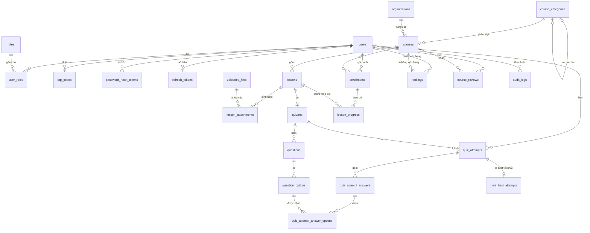

# Thiết kế cơ sở dữ liệu — SQL Server

> Phiên bản: 0.1 · Ngày lập: 2026-10-21 · Căn cứ: bộ SRS tại [`docs/srs`](../srs/README.md), đặc biệt [07-thiet-ke-csdl.md](../srs/07-thiet-ke-csdl.md) (thiết kế logic)

Thư mục này là **thiết kế vật lý** của CSDL cho website "Bình Dân Học Vụ Số" trên **Microsoft SQL Server 2019 trở lên**. Bản dùng cho production đề xuất là SQL Server 2022 Express (miễn phí).

## 1. Danh sách tài liệu

| File | Nội dung |
|------|----------|
| [01-quy-uoc-va-kieu-du-lieu.md](01-quy-uoc-va-kieu-du-lieu.md) | Phiên bản & edition, collation, quy ước đặt tên, ánh xạ kiểu dữ liệu, cách tìm kiếm tiếng Việt không dấu |
| [02-tu-dien-du-lieu.md](02-tu-dien-du-lieu.md) | Từ điển dữ liệu: 24 bảng, từng cột, kiểu, ràng buộc, ý nghĩa, truy vết về SRS |
| [03-rang-buoc-va-chi-muc.md](03-rang-buoc-va-chi-muc.md) | Khóa ngoại & hành vi khi xóa, phân tích đường cascade, CHECK, chỉ mục |
| [04-script-tao-csdl.md](04-script-tao-csdl.md) | Script T-SQL đầy đủ: tạo database, bảng, chỉ mục, dữ liệu khởi tạo (dùng làm Flyway `V1`, `V2`) |
| [05-truy-van-nghiep-vu.md](05-truy-van-nghiep-vu.md) | Truy vấn mẫu cho các nghiệp vụ chính: tìm kiếm, mở khóa bài, nộp quiz, xếp hạng, job dọn dẹp |
| [06-van-hanh-va-tich-hop.md](06-van-hanh-va-tich-hop.md) | Tích hợp Spring Boot/Flyway/JPA, phân quyền tài khoản DB, sao lưu, bảo trì, giám sát |
| [erd-tong-quan.mmd](erd-tong-quan.mmd) | Sơ đồ ERD Mermaid — chỉ bảng & quan hệ |
| [erd-chi-tiet.mmd](erd-chi-tiet.mmd) | Sơ đồ ERD Mermaid — đầy đủ cột & kiểu dữ liệu |

> Xem file `.mmd`: dùng extension "Mermaid Preview" / "Markdown Preview Mermaid Support" trong VS Code, hoặc dán vào <https://mermaid.live>.

## 2. Sơ đồ tổng quan

## 3. Phân nhóm bảng

| Nhóm | Bảng | Số bảng |
|------|------|:------:|
| Người dùng & xác thực | `roles`, `users`, `user_roles`, `otp_codes`, `password_reset_tokens`, `refresh_tokens` | 6 |
| Danh mục & nội dung | `uploaded_files`, `organizations`, `course_categories`, `courses`, `lessons`, `lesson_attachments`, `quizzes`, `questions`, `question_options` | 9 |
| Học tập | `enrollments`, `lesson_progress`, `quiz_attempts`, `quiz_attempt_answers`, `quiz_attempt_answer_options` | 5 |
| Xếp hạng | `quiz_best_attempts`, `rankings` | 2 |
| Đánh giá & hệ thống | `course_reviews`, `audit_logs` | 2 |
| **Tổng MVP** | | **24** |

Các bảng của Giai đoạn 2–3 (`certificates`, `notifications`, `blog_*`) đã được phác thảo trong [02-tu-dien-du-lieu.md](02-tu-dien-du-lieu.md) mục 7, nhưng chưa có trong script MVP.

## 4. Khác biệt so với thiết kế logic trong SRS 07 (PostgreSQL)

| Hạng mục | SRS 07 (PostgreSQL) | Thiết kế SQL Server | Lý do |
|----------|---------------------|---------------------|-------|
| Tìm kiếm không dấu | Extension `unaccent` + `pg_trgm` | Cột `courses.search_text` do ứng dụng chuẩn hóa (bỏ dấu, `đ→d`, chữ thường), tìm bằng `LIKE`. Khi dữ liệu lớn thì thêm Full-Text Search | SQL Server không có `unaccent`; collation `_AI` không quy đổi `đ` thành `d` |
| Kiểu chuỗi | `VARCHAR`/`TEXT` | `NVARCHAR(n)` / `NVARCHAR(MAX)` cho **mọi** cột chuỗi | Lưu tiếng Việt an toàn và tránh chuyển đổi kiểu ngầm khi JDBC gửi tham số Unicode (xem 01 §4) |
| Boolean | `BOOLEAN` | `BIT` | |
| Thời gian | `TIMESTAMPTZ` | `DATETIME2(3)` lưu **UTC** | |
| JSON | `JSONB` | `NVARCHAR(MAX)` + `CHECK (ISJSON(...) = 1)` | |
| Mảng đáp án đã chọn | `quiz_attempt_answers.selected_option_ids BIGINT[]` | Bảng con `quiz_attempt_answer_options` | SQL Server không có kiểu mảng; bảng con giữ được khóa ngoại |
| Unique một phần | Partial index `WHERE ...` | Filtered unique index `WHERE ...` | Tương đương |
| Ràng buộc 2 cấp danh mục | Trigger | Khai báo bằng khóa ngoại tổ hợp `(id, depth)` + CHECK, không cần trigger | Đơn giản, không lách được (xem 03 §3) |
| `UNIQUE ... DEFERRABLE` khi sắp xếp bài học | Có | Không hỗ trợ → cập nhật thứ tự trong **một câu `UPDATE`** | Xem 05 §6 |
| Tên cột trùng từ khóa | `level`, `type`, `action` | `course_level`, `question_type`, `action_type` | Tránh từ khóa dành riêng của ODBC/T-SQL |
| Bổ sung | — | Cột `version` (optimistic locking), `attempt_no`, `expires_at`, `completion_method`, `revoked_reason`, `hidden_by`, `is_active` cho câu hỏi/đáp án | Phục vụ đầy đủ quy tắc nghiệp vụ trong SRS |

## 5. Quyết định thiết kế chính

1. **Chỉ dùng schema `dbo`** và đặt tên `snake_case` để khớp với cách đặt tên mặc định của Spring Boot/Hibernate.
2. **Không dùng trigger, không dùng stored procedure bắt buộc.** Nghiệp vụ nằm ở tầng service. CSDL bảo vệ tính toàn vẹn bằng PK/FK/UNIQUE/CHECK.
3. **Cột tổng hợp** (`enrollment_count`, `rating_avg`, `published_lesson_count`, `rankings.*`) được ứng dụng cập nhật trong cùng transaction để truy vấn danh sách và xếp hạng nhanh.
4. **Bật `READ_COMMITTED_SNAPSHOT`** để thao tác đọc không chặn thao tác ghi (trang danh sách và bảng xếp hạng được đọc liên tục).
5. **Xóa mềm** cho `users`. Khóa học đã có học viên thì chỉ được `ARCHIVED`. Câu hỏi hay đáp án đã có người trả lời thì chỉ được tắt bằng `is_active = 0`. Khóa ngoại `NO ACTION` chặn việc xóa cứng dữ liệu đã phát sinh lịch sử.
