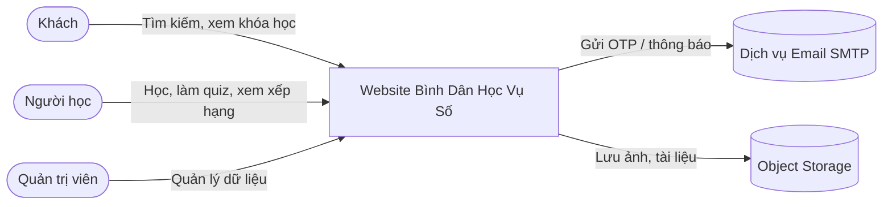

# 00 — Tổng quan dự án

## 1. Mục đích tài liệu

Tài liệu mô tả bức tranh tổng thể của website "Bình Dân Học Vụ Số": mục tiêu, phạm vi, đối tượng sử dụng, các giả định và những điểm còn cần chủ dự án quyết định. Đây là tài liệu nền cho các SRS chi tiết (02 → 11).

## 2. Bối cảnh & mục tiêu sản phẩm

"Bình Dân Học Vụ Số" là nền tảng học trực tuyến giúp người dân tiếp cận các khóa học (đặc biệt là kỹ năng số) một cách đơn giản, miễn phí và có lộ trình rõ ràng.

**Mục tiêu:**

1. Người học dễ dàng **tìm** được khóa học phù hợp theo lĩnh vực, trình độ, tổ chức đào tạo và trạng thái.
2. Người học **học theo lộ trình tuần tự**: hoàn thành bài trước mới mở bài sau, có quiz kiểm tra sau mỗi bài.
3. Người học **theo dõi được tiến độ** của mình và có động lực nhờ **bảng xếp hạng**.
4. Quản trị viên **quản lý tập trung** người dùng, danh mục, khóa học, bài học, câu hỏi quiz.
5. Quy trình phát triển chuẩn hóa trên GitHub với CI/CD tự động.

**Chỉ số thành công đề xuất (KPI) sau 3 tháng vận hành:**

| Chỉ số | Mục tiêu đề xuất |
|--------|------------------|
| Tỉ lệ đăng ký tài khoản xác thực OTP thành công | ≥ 85% |
| Tỉ lệ người đã đăng ký khóa học hoàn thành ít nhất 1 bài | ≥ 60% |
| Tỉ lệ hoàn thành khóa học | ≥ 25% |
| Thời gian phản hồi trang tìm kiếm (p95) | ≤ 1 giây |

## 3. Phạm vi

### 3.1 Trong phạm vi MVP (Giai đoạn 1)

- Xác thực: đăng ký (xác thực email bằng OTP), đăng nhập, đăng xuất, quên mật khẩu bằng OTP, đổi mật khẩu, cập nhật hồ sơ.
- Phân quyền 2 vai trò: `ADMIN`, `USER`.
- Trang người dùng: tìm kiếm & lọc khóa học kết hợp nhiều điều kiện, xem chi tiết khóa học (Giới thiệu, Giáo trình, Đánh giá), đăng ký học, thanh tiến độ.
- Học tập: nội dung bài học, đề bài, quiz trắc nghiệm, mở khóa bài tuần tự, lưu tiến độ.
- Xếp hạng theo từng khóa học (điểm giảm dần, bằng điểm thì thời gian làm bài tăng dần).
- Trang quản trị: CRUD người dùng, loại khóa học 2 cấp, tổ chức đào tạo, khóa học, bài học, quiz.
- Quy trình Git (main / develop / feat / fix) và CI/CD.

### 3.2 Giai đoạn sau (ngoài MVP)

| Tính năng | Giai đoạn | Ghi chú |
|-----------|-----------|---------|
| Chứng nhận hoàn thành khóa học (PDF có mã xác minh) | 2 | Ý tưởng 2 trong knowledge base có ghi "(chứng nhận)" |
| Bảng xếp hạng toàn hệ thống (cộng dồn mọi khóa) | 2 | |
| Thông báo (email/in-app) khi có khóa học mới, nhắc học | 2 | |
| Đăng nhập bằng Google / VNeID | 2 | Cần đánh giá khả năng tích hợp |
| Dashboard thống kê nâng cao cho Admin | 2 | MVP chỉ có số liệu cơ bản |
| Blog / tin tức | 3 | Knowledge base ghi "(Blog): mở rộng" |
| Vai trò Giảng viên / Quản lý tổ chức đào tạo | 3 | Xem Q-02 |
| Ứng dụng di động | Chưa lên kế hoạch | MVP dùng web responsive |

### 3.3 Ngoài phạm vi

- Thanh toán / khóa học có phí.
- Lớp học trực tuyến thời gian thực (livestream, video call).
- Chấm bài tự luận thủ công.

## 4. Tác nhân (Actors)

| Tác nhân | Mô tả | Quyền chính |
|----------|-------|-------------|
| **Khách** (Guest) | Người truy cập chưa đăng nhập | Tìm kiếm, xem chi tiết khóa học, xem bảng xếp hạng, đăng ký tài khoản |
| **Người học** (`USER`) | Người dùng đã đăng nhập, email đã xác thực | Mọi quyền của Khách + đăng ký học, vào học, làm quiz, đánh giá khóa học, quản lý hồ sơ |
| **Quản trị viên** (`ADMIN`) | Nhân sự vận hành nền tảng | Toàn quyền trang quản trị |
| **Hệ thống email** | Gmail SMTP (miễn phí), backend gửi qua Java Mail | Gửi OTP, thông báo |

## 5. Sơ đồ ngữ cảnh

## 6. Thuật ngữ

| Thuật ngữ | Giải thích |
|-----------|-----------|
| Loại khóa học cấp 1 | Lĩnh vực lớn, ví dụ "Kỹ năng số", "Ngoại ngữ" |
| Loại khóa học cấp 2 | Lĩnh vực con thuộc cấp 1, ví dụ "Kỹ năng số → An toàn thông tin" |
| Tổ chức đào tạo | Đơn vị cung cấp/biên soạn khóa học |
| Trình độ | Mức độ khóa học: Cơ bản / Trung cấp / Nâng cao |
| Giáo trình | Danh sách bài học có thứ tự của khóa học |
| Bài học | Đơn vị học gồm nội dung lý thuyết, đề bài (bài tập) và quiz |
| Đề bài | Phần bài tập/yêu cầu thực hành gắn với bài học |
| Quiz | Bộ câu hỏi trắc nghiệm chấm tự động ở cuối bài học |
| Ghi danh (Enrollment) | Việc người học đăng ký tham gia một khóa học |
| OTP | Mã dùng một lần gửi qua email, dùng để xác thực |
| MVP | Phiên bản tối thiểu đưa vào sử dụng |

## 7. Giả định & ràng buộc

| Mã | Giả định / ràng buộc |
|----|----------------------|
| A-01 | Toàn bộ khóa học **miễn phí**, không có thanh toán. |
| A-02 | Ngôn ngữ giao diện: **tiếng Việt**. Chưa cần đa ngôn ngữ. |
| A-03 | Nội dung khóa học do **Admin** nhập (chưa có vai trò giảng viên). |
| A-04 | Quiz chỉ gồm câu hỏi **trắc nghiệm chấm tự động** (1 đáp án, nhiều đáp án, Đúng/Sai). |
| A-05 | Công nghệ: Java Spring Boot + ReactJS + **Microsoft SQL Server** (đã chốt CSDL). Xem tài liệu 01 và thiết kế CSDL tại [`docs/design-db`](../design-db/README.md). |
| A-06 | Video bài học được nhúng từ nền tảng ngoài (YouTube/Vimeo) hoặc lưu ở object storage; hệ thống không tự transcode video. |
| A-07 | Người dùng mục tiêu bao gồm người lớn tuổi, ít kinh nghiệm công nghệ → giao diện phải đơn giản, chữ lớn, tương phản tốt (xem NFR khả năng truy cập). |
| C-01 | Mã nguồn lưu trữ trên GitHub, tuân thủ quy trình nhánh tại tài liệu 10. |
| C-02 | Tuân thủ Nghị định 13/2023/NĐ-CP về bảo vệ dữ liệu cá nhân. |

## 8. Câu hỏi mở (cần chủ dự án xác nhận)

| Mã | Câu hỏi | Đề xuất mặc định trong tài liệu này |
|----|---------|--------------------------------------|
| Q-01 | Chốt công nghệ backend/frontend/CSDL? | Spring Boot 3 (Java 21) + React (Vite, TypeScript) + SQL Server 2022 (**CSDL đã chốt: SQL Server**) |
| Q-02 | Có cần vai trò Giảng viên / Quản lý tổ chức đào tạo tự tạo khóa học không? | Không trong MVP; thiết kế DB để mở rộng (bảng `roles` riêng) |
| Q-03 | Bộ lọc "trạng thái" nghĩa là trạng thái khóa học (Sắp mở / Đang mở / Đã kết thúc) hay trạng thái học của tôi (Chưa học / Đang học / Đã hoàn thành)? | Hỗ trợ **cả hai**: trạng thái khóa học cho mọi người, trạng thái học tập chỉ khi đã đăng nhập |
| Q-04 | Chi tiết khóa học dùng ý tưởng 1 (Giới thiệu + Nội dung) hay ý tưởng 2 (Giới thiệu, Giáo trình, Đánh giá, Chứng nhận)? | Ý tưởng 2; tab "Chứng nhận" chỉ hiển thị thông tin ở MVP, cấp chứng nhận ở Giai đoạn 2 |
| Q-05 | Điểm xếp hạng tính theo lần làm quiz **cao nhất** hay **lần đầu tiên**? | Lần cao nhất của mỗi quiz (khuyến khích học lại) |
| Q-06 | Có giới hạn số lần làm lại quiz không? | Cấu hình theo từng quiz; mặc định không giới hạn |
| Q-07 | "Đề bài" có cần người học nộp bài (file/tự luận) không? | Không trong MVP — đề bài chỉ để đọc/thực hành; việc chấm điểm dựa trên quiz |
| Q-08 | Xếp hạng theo từng khóa học hay toàn hệ thống? | Theo từng khóa ở MVP; toàn hệ thống ở Giai đoạn 2 |
| Q-09 | Những trường thông tin người dùng nào là bắt buộc? (knowledge base ghi "tên, năm sinh, quê, nơi công tác, ...") | Bắt buộc: họ tên, email, mật khẩu. Tùy chọn: năm sinh, quê quán, nơi công tác, số điện thoại |
| Q-10 | Môi trường hosting/deploy (VPS, cloud nào)? | Docker trên VPS/Cloud VM; có môi trường staging và production |
| Q-11 | Quy mô người dùng dự kiến? | 10.000 người dùng đăng ký, 500 người dùng đồng thời trong năm đầu |
