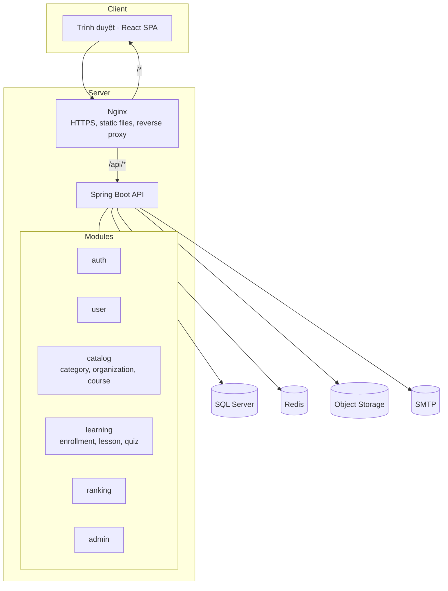

# 01 — Kiến trúc hệ thống & công nghệ

> Trạng thái: **Đề xuất** — chờ xác nhận tại câu hỏi Q-01 ([00-tong-quan.md](00-tong-quan.md)).

## 1. Công nghệ đề xuất

| Tầng | Công nghệ | Lý do chọn |
|------|-----------|-----------|
| Backend | Java 21, Spring Boot 3.x (Spring Web, Spring Security, Spring Data JPA, Validation, Mail) | Repo đã có `.gitignore` Java; hệ sinh thái bảo mật/ORM trưởng thành |
| Migration CSDL | Flyway | Quản lý phiên bản schema trong mã nguồn |
| CSDL | Microsoft SQL Server 2022 (Express cho production MVP — miễn phí; Developer cho dev), collation `Vietnamese_100_CI_AS` | Sắp xếp đúng tiếng Việt; thiết kế chi tiết tại [`docs/design-db`](../design-db/README.md) |
| Cache / rate limit | Redis 7 | Lưu bộ đếm OTP, rate limit, cache bảng xếp hạng |
| Frontend | React 18 + TypeScript + Vite, React Router, TanStack Query, Tailwind CSS | SPA nhẹ, dễ tuyển dụng; Tailwind giúp làm giao diện đồng nhất nhanh |
| Soạn nội dung bài học | Trình soạn thảo rich text (TipTap) lưu HTML đã làm sạch | Admin nhập nội dung có định dạng, ảnh, video nhúng |
| Lưu trữ tệp | S3-compatible (MinIO khi dev, S3/Cloud storage khi production) | Ảnh bìa khóa học, ảnh trong bài học, logo tổ chức |
| Email | Java Mail (Jakarta Mail qua `spring-boot-starter-mail` / `JavaMailSender`) kết nối SMTP miễn phí của Gmail (đăng nhập bằng App Password) | Gửi OTP, thông báo; thư viện miễn phí, không phát sinh chi phí dịch vụ email |
| Tài liệu API | springdoc-openapi (Swagger UI) | Sinh tài liệu API tự động |
| Kiểm thử | JUnit 5, Mockito, Testcontainers (BE); Vitest, React Testing Library, Playwright (FE) | |
| Đóng gói & triển khai | Docker, Docker Compose; Nginx reverse proxy + HTTPS (Let's Encrypt) | |
| CI/CD | GitHub Actions, GitHub Container Registry (GHCR) | Xem tài liệu 10 |
| Giám sát | Spring Boot Actuator, Prometheus + Grafana (hoặc dịch vụ tương đương), log JSON | |

> **Lưu ý về email:** Java Mail chỉ là thư viện gửi thư, vẫn cần một máy chủ SMTP. Phương án miễn phí là SMTP của tài khoản Gmail (`smtp.gmail.com:587`, STARTTLS, bật xác minh 2 bước và tạo App Password). Giới hạn của Gmail cá nhân vào khoảng **500 email/ngày**. Khi lượng OTP vượt mức này, chỉ cần đổi các tham số `spring.mail.*` sang SMTP khác mà không phải sửa code.
>
> Khi dev local dùng MailHog để bắt email, không gửi email thật.

> Nếu nhóm quen Node.js hơn, phương án thay thế là NestJS + Prisma; các tài liệu nghiệp vụ, CSDL và API không thay đổi.

## 2. Kiến trúc tổng thể

Kiến trúc **modular monolith**: một ứng dụng backend duy nhất, chia module theo nghiệp vụ, giúp đơn giản hóa vận hành ở giai đoạn đầu và có thể tách dịch vụ sau này.



### 2.1 Phân lớp trong mỗi module backend

```
controller  → nhận request, validate DTO, trả response
service     → nghiệp vụ, transaction
repository  → truy cập dữ liệu (Spring Data JPA)
domain      → entity, enum
dto/mapper  → đối tượng vào/ra, ánh xạ (MapStruct)
```

### 2.2 Luồng xác thực

- Access token: JWT, thời hạn 15 phút, gửi qua header `Authorization: Bearer <token>`.
- Refresh token: chuỗi ngẫu nhiên, thời hạn 7 ngày, lưu dạng hash trong DB, gửi qua cookie `HttpOnly; Secure; SameSite=Strict`, xoay vòng (rotation) mỗi lần làm mới.
- Chi tiết: tài liệu [02](02-xac-thuc-phan-quyen.md).

## 3. Cấu trúc repository (monorepo)

```
binh-dan-hoc-vu-so/
├── backend/                 # Spring Boot
│   ├── src/main/java/vn/bdhvs/
│   │   ├── auth/  user/  catalog/  learning/  ranking/  admin/
│   │   └── common/          # exception, security, config, util
│   ├── src/main/resources/
│   │   ├── db/migration/    # Flyway V1__init.sql, ...
│   │   └── application.yml
│   └── pom.xml
├── frontend/                # React + Vite
│   ├── src/
│   │   ├── pages/           # public/, learner/, admin/
│   │   ├── components/
│   │   ├── features/        # auth, courses, learning, ranking, admin
│   │   └── api/             # client gọi API
│   └── package.json
├── docs/
│   └── srs/                 # bộ tài liệu này
├── knowledge_base/
├── deploy/                  # docker-compose.*.yml, nginx.conf
└── .github/
    ├── workflows/           # ci.yml, deploy-staging.yml, deploy-prod.yml
    └── pull_request_template.md
```

## 4. Môi trường

| Môi trường | Nhánh nguồn | Mục đích | Dữ liệu |
|------------|-------------|----------|---------|
| Local | nhánh cá nhân | Lập trình viên phát triển | Dữ liệu mẫu (seed) qua Docker Compose |
| Staging | `develop` | Kiểm thử tích hợp, UAT | Dữ liệu giả lập, không dùng dữ liệu thật |
| Production | `main` | Người dùng thật | Dữ liệu thật, sao lưu hằng ngày |

## 5. Cấu hình & bí mật

- Mọi bí mật (mật khẩu DB, JWT secret, SMTP, khóa S3) truyền qua biến môi trường; **không commit** vào repo.
- Trên GitHub dùng *Environments* `staging` / `production` để lưu secrets và yêu cầu phê duyệt khi deploy production.
- Bổ sung vào `.gitignore`: `.env`, `node_modules/`, `dist/`, `target/`, `.idea/`, `.vscode/`.
