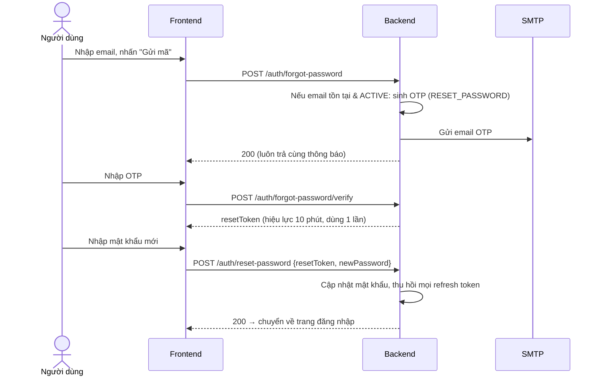
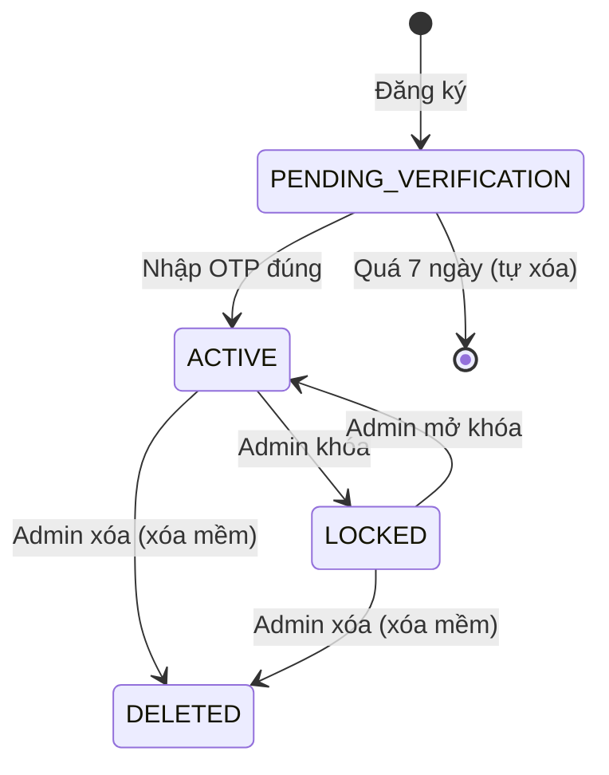

# 02 — Xác thực & phân quyền (Authentication & Authorization)

Nguồn: `knowledge_base/Authen & author.txt`, `knowledge_base/Thiết kế DB.txt` (Role).

## 1. Danh sách yêu cầu chức năng

| Mã | Chức năng | Tác nhân | Ưu tiên |
|----|-----------|----------|---------|
| FR-AUTH-01 | Đăng ký tài khoản bằng email | Khách | M |
| FR-AUTH-02 | Xác thực email bằng OTP | Khách | M |
| FR-AUTH-03 | Gửi lại OTP | Khách | M |
| FR-AUTH-04 | Đăng nhập bằng email + mật khẩu | Khách | M |
| FR-AUTH-05 | Làm mới phiên đăng nhập (refresh token) | Người dùng | M |
| FR-AUTH-06 | Đăng xuất | Người dùng | M |
| FR-AUTH-07 | Quên mật khẩu — đặt lại mật khẩu qua OTP | Khách | M |
| FR-AUTH-08 | Đổi mật khẩu khi đã đăng nhập | Người dùng | M |
| FR-AUTH-09 | Xem & cập nhật hồ sơ cá nhân | Người dùng | M |
| FR-AUTH-10 | Phân quyền theo vai trò (ADMIN, USER) | Hệ thống | M |
| FR-AUTH-11 | Đăng nhập bằng Google | Khách | C (Giai đoạn 2) |

## 2. Đặc tả chi tiết

### FR-AUTH-01 — Đăng ký tài khoản

**Dữ liệu nhập:**

| Trường | Bắt buộc | Ràng buộc |
|--------|----------|-----------|
| Họ và tên | Có | 2–100 ký tự |
| Email | Có | Đúng định dạng, duy nhất trong hệ thống (không phân biệt hoa thường) |
| Mật khẩu | Có | Theo BR-AUTH-01 |
| Xác nhận mật khẩu | Có | Trùng với mật khẩu |
| Năm sinh | Không | 1900 → năm hiện tại |
| Quê quán | Không | ≤ 255 ký tự (tỉnh/thành phố) |
| Nơi công tác | Không | ≤ 255 ký tự |
| Số điện thoại | Không | Định dạng số điện thoại Việt Nam |
| Đồng ý điều khoản & chính sách dữ liệu cá nhân | Có | Checkbox phải được chọn |

**Luồng chính:**

1. Khách nhập thông tin và nhấn "Đăng ký".
2. Hệ thống kiểm tra dữ liệu; nếu email đã tồn tại và **đã xác thực** → báo lỗi "Email đã được sử dụng".
3. Nếu email đã tồn tại nhưng **chưa xác thực** → cập nhật lại thông tin và gửi OTP mới (cho phép đăng ký lại).
4. Hệ thống tạo tài khoản trạng thái `PENDING_VERIFICATION`, vai trò `USER`, băm mật khẩu bằng BCrypt.
5. Hệ thống sinh OTP (mục đích `REGISTER`) và gửi email.
6. Chuyển sang màn hình nhập OTP.

**Tiêu chí chấp nhận:**

- [ ] Mật khẩu không bao giờ được lưu hoặc ghi log dạng rõ.
- [ ] Tài khoản `PENDING_VERIFICATION` không đăng nhập được.
- [ ] Email gửi tới trong vòng 1 phút (trong điều kiện SMTP hoạt động bình thường).

### FR-AUTH-02 — Xác thực OTP

1. Người dùng nhập mã OTP 6 chữ số.
2. Hệ thống kiểm tra mã theo BR-AUTH-02, BR-AUTH-03.
3. Đúng → tài khoản chuyển `ACTIVE`, ghi `email_verified_at`, đánh dấu OTP đã dùng, tự động đăng nhập (cấp token) và chuyển về trang chủ.
4. Sai → báo "Mã OTP không đúng, bạn còn N lần thử". Hết lượt → OTP bị vô hiệu, yêu cầu gửi lại.
5. Hết hạn → báo "Mã OTP đã hết hạn", hiển thị nút gửi lại.

### FR-AUTH-03 — Gửi lại OTP

- Nút "Gửi lại mã" bị vô hiệu trong 60 giây kể từ lần gửi trước (có đếm ngược).
- Khi gửi lại, mọi OTP cũ cùng mục đích của email đó bị vô hiệu.
- Áp dụng giới hạn theo BR-AUTH-04.

### FR-AUTH-04 — Đăng nhập

1. Người dùng nhập email, mật khẩu.
2. Hệ thống kiểm tra:
   - Sai thông tin → thông báo chung "Email hoặc mật khẩu không đúng" (không tiết lộ email có tồn tại hay không).
   - Tài khoản `PENDING_VERIFICATION` → chuyển tới màn hình OTP và gửi OTP mới.
   - Tài khoản `LOCKED` (bị admin khóa) → "Tài khoản đã bị khóa, vui lòng liên hệ quản trị viên".
   - Đang bị khóa tạm do sai nhiều lần (BR-AUTH-05) → thông báo thời gian chờ.
3. Thành công → cấp access token + refresh token, cập nhật `last_login_at`.
4. Điều hướng: `ADMIN` → `/admin`; `USER` → trang trước đó hoặc trang chủ.

Tùy chọn "Ghi nhớ đăng nhập": nếu chọn, refresh token có hạn 30 ngày thay vì 7 ngày.

### FR-AUTH-05 — Làm mới phiên

- Khi access token hết hạn, frontend gọi API refresh bằng cookie refresh token.
- Refresh token được **xoay vòng**: token cũ bị thu hồi, cấp token mới.
- Nếu phát hiện một refresh token đã bị thu hồi được dùng lại → thu hồi toàn bộ refresh token của người dùng đó (nghi bị đánh cắp).

### FR-AUTH-06 — Đăng xuất

- Thu hồi refresh token hiện tại, xóa cookie, xóa trạng thái phía client.
- Tùy chọn "Đăng xuất khỏi tất cả thiết bị" trong trang hồ sơ: thu hồi mọi refresh token.

### FR-AUTH-07 — Quên mật khẩu



- Thông báo luôn là "Nếu email tồn tại trong hệ thống, mã xác thực đã được gửi" để tránh dò email.
- Sau khi đặt lại thành công, gửi email thông báo "Mật khẩu của bạn vừa được thay đổi".

### FR-AUTH-08 — Đổi mật khẩu

- Nhập mật khẩu hiện tại, mật khẩu mới, xác nhận mật khẩu mới.
- Mật khẩu mới phải khác mật khẩu hiện tại và tuân thủ BR-AUTH-01.
- Thành công → thu hồi các refresh token khác (giữ phiên hiện tại), gửi email thông báo.

### FR-AUTH-09 — Hồ sơ cá nhân

- Xem và sửa: họ tên, năm sinh, quê quán, nơi công tác, số điện thoại, ảnh đại diện (JPG/PNG ≤ 2MB).
- Email **không** được tự đổi ở MVP (đổi email cần quy trình xác thực riêng — Giai đoạn 2).
- Trang hồ sơ hiển thị thêm: danh sách khóa học đã đăng ký kèm tiến độ (liên kết tài liệu 04).

### FR-AUTH-10 — Phân quyền (RBAC)

| Tài nguyên / hành động | Khách | USER | ADMIN |
|------------------------|:-----:|:----:|:-----:|
| Xem danh sách, tìm kiếm, chi tiết khóa học | ✔ | ✔ | ✔ |
| Xem bảng xếp hạng khóa học | ✔ | ✔ | ✔ |
| Đăng ký học, vào học, làm quiz | | ✔ | ✔ |
| Viết đánh giá khóa học (đã ghi danh) | | ✔ | ✔ |
| Xem/sửa hồ sơ của chính mình | | ✔ | ✔ |
| Truy cập `/admin` và API `/api/admin/**` | | | ✔ |

- Backend kiểm tra quyền ở **mọi** API (không chỉ ẩn nút ở frontend).
- Người dùng chỉ truy cập được dữ liệu của chính mình (enrollment, lượt làm quiz, hồ sơ); truy cập dữ liệu người khác → `403`.
- Một người dùng có thể có nhiều vai trò (thiết kế bảng `user_roles`), để mở rộng vai trò Giảng viên sau này.

## 3. Quy tắc nghiệp vụ

| Mã | Quy tắc |
|----|---------|
| BR-AUTH-01 | Mật khẩu: 8–64 ký tự, có ít nhất 1 chữ cái và 1 chữ số; không trùng email. |
| BR-AUTH-02 | OTP: 6 chữ số ngẫu nhiên (sinh bằng `SecureRandom`), hiệu lực **5 phút**, dùng **1 lần**, lưu dạng hash. |
| BR-AUTH-03 | Mỗi OTP cho phép tối đa **5 lần nhập sai**; vượt quá → vô hiệu OTP. |
| BR-AUTH-04 | Mỗi email: tối đa **5 lần gửi OTP / giờ**, cách nhau tối thiểu **60 giây**. Mỗi IP: tối đa 20 yêu cầu OTP / giờ. |
| BR-AUTH-05 | Đăng nhập sai **5 lần liên tiếp** → khóa tạm tài khoản **15 phút**. Đếm lại từ đầu khi đăng nhập thành công. |
| BR-AUTH-06 | Tài khoản `PENDING_VERIFICATION` quá 7 ngày không xác thực sẽ bị xóa tự động (job chạy hằng ngày). |
| BR-AUTH-07 | Phải luôn tồn tại ít nhất 1 tài khoản `ADMIN` đang `ACTIVE`. |

## 4. Trạng thái tài khoản



## 5. Màn hình

| Mã | Màn hình | Thành phần chính |
|----|----------|------------------|
| SCR-AUTH-01 | Đăng nhập | Email, mật khẩu (nút hiện/ẩn), "Ghi nhớ đăng nhập", liên kết "Quên mật khẩu", "Đăng ký" |
| SCR-AUTH-02 | Đăng ký | Form theo FR-AUTH-01, chỉ báo độ mạnh mật khẩu |
| SCR-AUTH-03 | Nhập OTP | 6 ô nhập số, đếm ngược hiệu lực, nút "Gửi lại mã" có đếm ngược 60s |
| SCR-AUTH-04 | Quên mật khẩu | Bước 1 nhập email → bước 2 nhập OTP → bước 3 mật khẩu mới |
| SCR-AUTH-05 | Hồ sơ cá nhân | Thông tin cá nhân, đổi mật khẩu, khóa học của tôi, đăng xuất mọi thiết bị |

## 6. Mẫu email OTP

```
Tiêu đề: [Bình Dân Học Vụ Số] Mã xác thực của bạn

Xin chào {họ tên},

Mã xác thực của bạn là: 123456
Mã có hiệu lực trong 5 phút. Không chia sẻ mã này cho bất kỳ ai.

Nếu bạn không thực hiện yêu cầu này, vui lòng bỏ qua email.
```
