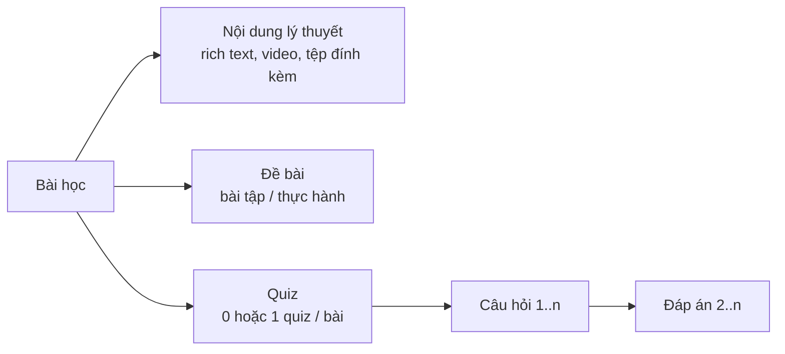
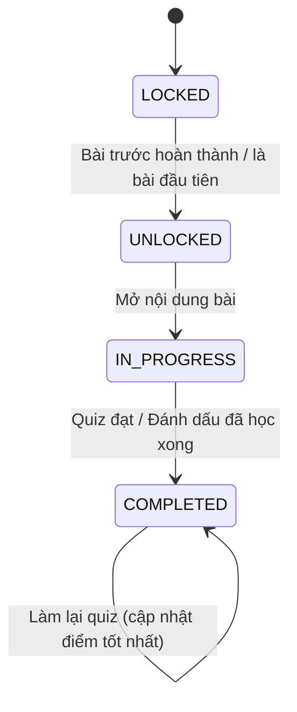

# 04 — Học tập & Quiz

Nguồn: `knowledge_base/- Trang người dung.txt` — *"Vào học: bài học: đề bài, quiz, làm bài lần lượt có điều kiện (xong bài trước mới mở khóa bài sau)"*, *"đăng ký học: thêm thanh check tiến độ học"*.

## 1. Danh sách yêu cầu chức năng

| Mã | Chức năng | Ưu tiên |
|----|-----------|---------|
| FR-LRN-01 | Trang học (learning player): danh sách bài + nội dung bài | M |
| FR-LRN-02 | Xem nội dung bài học (lý thuyết, video, tệp đính kèm) | M |
| FR-LRN-03 | Xem đề bài (bài tập/thực hành) của bài học | M |
| FR-LRN-04 | Làm quiz cuối bài | M |
| FR-LRN-05 | Chấm điểm tự động & xem kết quả quiz | M |
| FR-LRN-06 | Làm lại quiz | M |
| FR-LRN-07 | Mở khóa bài học tuần tự | M |
| FR-LRN-08 | Thanh tiến độ học tập | M |
| FR-LRN-09 | Tiếp tục học từ vị trí dừng gần nhất | S |
| FR-LRN-10 | Lịch sử các lần làm quiz | S |
| FR-LRN-11 | Hoàn thành khóa học | M |
| FR-LRN-12 | Thời hạn học: đóng khóa học & xóa dữ liệu khi hết hạn, học lại từ đầu | M |
| FR-LRN-13 | Email nhắc sắp hết thời hạn học | S |

Tất cả chức năng trong tài liệu này yêu cầu: người dùng đã đăng nhập **và** đã ghi danh khóa học (enrollment `IN_PROGRESS` hoặc `COMPLETED`) **và** lượt ghi danh chưa hết thời hạn học (FR-LRN-12).

## 2. Cấu trúc một bài học



- Mỗi bài học có **tối đa 1 quiz**. Bài không có quiz được hoàn thành bằng nút "Đánh dấu đã học xong".
- Loại câu hỏi: `SINGLE_CHOICE` (1 đáp án đúng), `MULTIPLE_CHOICE` (≥ 1 đáp án đúng), `TRUE_FALSE`.

## 3. Đặc tả chi tiết

### FR-LRN-01 — Trang học

Bố cục 2 cột (trên di động: danh sách bài thu gọn thành menu):

```
┌──────────────────────┬────────────────────────────────────────┐
│ Tên khóa học         │  Bài 3: Tạo mật khẩu an toàn           │
│ ███████░░░░ 40%      │  [Nội dung] [Đề bài] [Quiz]            │
│ Hạn học: còn 12 ngày │                                        │
│ ✅ 1. Giới thiệu     │  (nội dung bài học / video)            │
│ ✅ 2. Tài khoản số   │                                        │
│ ▶️ 3. Mật khẩu       │                                        │
│ 🔒 4. Lừa đảo mạng   │                                        │
│ 🔒 5. Tổng kết       │  [◀ Bài trước]        [Làm quiz ▶]     │
└──────────────────────┴────────────────────────────────────────┘
```

- Đường dẫn: `/hoc/:courseSlug/bai/:lessonId`.
- Nhấn vào bài bị khóa → thông báo "Hoàn thành bài N để mở khóa bài này".
- Truy cập trực tiếp URL bài bị khóa → backend trả `403 LESSON_LOCKED`, frontend chuyển về bài đang học.
- Lượt ghi danh đã hết thời hạn học → backend trả `403 ENROLLMENT_EXPIRED`, frontend chuyển về trang chi tiết khóa học (FR-LRN-12).

### FR-LRN-02 & FR-LRN-03 — Nội dung & đề bài

- Nội dung: HTML đã được làm sạch (sanitize) ở backend khi lưu; video nhúng YouTube/Vimeo hoặc tệp MP4; tệp đính kèm (PDF, DOCX, XLSX ≤ 20MB) tải về được.
- Đề bài: mô tả yêu cầu thực hành; ở MVP người học **không nộp bài** (xem Q-07). Mục đích là hướng dẫn tự thực hành trước khi làm quiz.
- Hệ thống ghi nhận lần đầu người học mở bài (`lesson_progress.status = IN_PROGRESS`, `started_at`).

### FR-LRN-04 — Làm quiz

1. Người học nhấn "Làm quiz". Màn hình hiển thị: số câu, thời gian giới hạn (nếu có), điểm đạt, số lần làm còn lại (nếu có giới hạn).
2. Nhấn "Bắt đầu" → backend tạo `quiz_attempt` (status `IN_PROGRESS`, `started_at` = thời gian máy chủ) và trả về đề **không kèm đáp án đúng**.
3. Thứ tự câu hỏi/đáp án được xáo trộn nếu quiz bật `shuffle`.
4. Có đồng hồ đếm ngược nếu quiz có `time_limit_seconds`; bảng điều hướng câu (đã trả lời / chưa trả lời).
5. Người học nhấn "Nộp bài" → xác nhận nếu còn câu chưa trả lời.
6. Hết giờ → frontend tự nộp; backend vẫn chấp nhận bài nộp trễ tối đa 30 giây (bù độ trễ mạng), quá mức đó chỉ chấm các câu đã lưu.
7. Đáp án được tự động lưu nháp phía client (localStorage) để không mất khi lỡ tải lại trang.
8. Mỗi người chỉ có **1 lượt làm `IN_PROGRESS`** cho mỗi quiz tại một thời điểm; mở lại trang sẽ tiếp tục lượt đó (nếu chưa hết giờ).

### FR-LRN-05 — Chấm điểm & kết quả

**Quy tắc chấm (BR-LRN-03):**

- `SINGLE_CHOICE`, `TRUE_FALSE`: chọn đúng → đủ điểm câu; sai/bỏ trống → 0.
- `MULTIPLE_CHOICE`: chọn **đúng và đủ** tập đáp án đúng → đủ điểm; ngược lại → 0 (không chấm điểm từng phần ở MVP).
- `score` = tổng điểm các câu đúng; `max_score` = tổng điểm các câu; `score_percent` = score / max_score × 100.
- **Đạt** khi `score_percent ≥ pass_score_percent` của quiz (mặc định 70%).
- `duration_seconds` = `submitted_at − started_at` (tính bằng thời gian máy chủ, không tin thời gian client).

**Màn hình kết quả:** điểm, phần trăm, Đạt/Chưa đạt, thời gian làm bài, số câu đúng/tổng; danh sách câu hỏi kèm đáp án đã chọn, đáp án đúng và giải thích (nếu quiz cho phép `show_answers_after_submit`).

Nếu đạt → nút "Bài tiếp theo"; nếu chưa đạt → nút "Làm lại" + gợi ý ôn lại nội dung.

### FR-LRN-06 — Làm lại quiz

- Được làm lại không giới hạn, trừ khi quiz cấu hình `max_attempts` (Q-06).
- Có thể đặt thời gian chờ giữa 2 lần làm (`retry_cooldown_seconds`, mặc định 0).
- Làm lại sau khi đã đạt **vẫn được phép** (để cải thiện điểm xếp hạng) — điểm xếp hạng lấy lần tốt nhất (tài liệu 05).

### FR-LRN-07 — Mở khóa tuần tự

**Điều kiện hoàn thành bài học (BR-LRN-01):**

| Bài học | Điều kiện hoàn thành |
|---------|----------------------|
| Có quiz | Có ít nhất 1 lượt làm quiz **Đạt** |
| Không có quiz | Người học nhấn "Đánh dấu đã học xong" (nút chỉ bật sau khi đã mở nội dung bài tối thiểu 30 giây) |

**Điều kiện mở khóa (BR-LRN-02):**

- Bài đầu tiên (theo `order_index`) được mở ngay khi ghi danh.
- Bài thứ *k* được mở khi **tất cả bài đã xuất bản đứng trước** nó đã hoàn thành.
- Bài đã từng được mở/hoàn thành thì **giữ nguyên** quyền truy cập, kể cả khi Admin chèn thêm bài mới phía trước (bài mới chèn vào trở thành bài người học cần hoàn thành để mở các bài *chưa mở* phía sau).
- Kiểm tra mở khóa được thực hiện ở **backend** cho cả việc xem nội dung lẫn bắt đầu quiz.



> `LOCKED`/`UNLOCKED` được **tính toán** khi truy vấn; chỉ `IN_PROGRESS`/`COMPLETED` được lưu trong bảng `lesson_progress`.

### FR-LRN-08 — Thanh tiến độ

- `progress_percent = số bài đã hoàn thành / tổng số bài đã xuất bản × 100` (làm tròn xuống số nguyên).
- Hiển thị ở: trang học, trang chi tiết khóa học, thẻ khóa học, trang "Khóa học của tôi".
- Tiến độ được cập nhật ngay sau khi hoàn thành bài (không cần tải lại trang).
- Khi Admin thêm/xóa bài học, tiến độ được tính lại (job nền hoặc tính khi đọc).

### FR-LRN-09 — Tiếp tục học

- Lưu `last_lesson_id` trên enrollment mỗi khi người học mở một bài.
- Nút "Tiếp tục học" đưa đến `last_lesson_id`; nếu chưa có → bài đầu tiên chưa hoàn thành.

### FR-LRN-10 — Lịch sử làm quiz

- Danh sách các lượt: thời điểm, điểm, thời gian làm bài, Đạt/Chưa đạt; đánh dấu lượt tốt nhất.
- Xem lại chi tiết từng lượt (nếu quiz cho phép hiện đáp án).

### FR-LRN-11 — Hoàn thành khóa học

- Khi **tất cả** bài đã xuất bản hoàn thành → enrollment chuyển `COMPLETED`, ghi `completed_at`, hiển thị màn hình chúc mừng.
- Nếu sau đó Admin thêm bài mới: enrollment vẫn giữ `COMPLETED`, tiến độ hiển thị theo công thức mới, bài mới được mở để học thêm (không bắt buộc).
- Giai đoạn 2: kiểm tra điều kiện và cấp chứng nhận.

### FR-LRN-12 — Thời hạn học

Mỗi lượt ghi danh chỉ được học trong một khoảng thời gian giới hạn. Hết thời hạn mà chưa hoàn thành thì khóa học bị đóng, dữ liệu học tập bị xóa và người học phải đăng ký học lại từ đầu.

**Thời hạn học của khóa** — cột `courses.learning_duration_days`:

- Giá trị **mặc định: 21 ngày (3 tuần)**.
- Admin đặt riêng cho từng khóa học trong form khóa học (FR-ADM-13), từ 1 đến 365 ngày.

**Mốc thời gian của một lượt ghi danh (BR-LRN-09):**

| Mốc | Cách tính |
|-----|-----------|
| `learning_started_at` — bắt đầu tính hạn | Thời điểm ghi danh. Nếu khóa "Sắp mở" thì lấy `start_date` của khóa, vì trước đó người học chưa vào học được (BR-LRN-06) |
| `expires_at` — hết hạn | `learning_started_at + learning_duration_days` (giờ máy chủ, chính xác tới giây) |

- Hai mốc được **chốt khi ghi danh**. Admin đổi thời hạn của khóa thì chỉ áp dụng cho các lượt ghi danh mới và các lượt học lại về sau. Lượt đang học giữ nguyên hạn cũ.
- Hủy ghi danh (FR-CRS-11) **không dừng** đồng hồ.

**Hiển thị hạn học:**

- Trang học, trang chi tiết khóa học và thẻ ở trang "Khóa học của tôi" hiển thị "Hạn học: dd/mm/yyyy hh:mm — còn X ngày Y giờ".
- Còn ≤ 3 ngày: thanh cảnh báo màu vàng ở đầu trang học.
- Còn ≤ 24 giờ: cảnh báo đỏ, đếm ngược giờ:phút.
- Khi bắt đầu quiz có giới hạn thời gian mà thời gian làm bài vượt quá hạn học còn lại → hỏi xác nhận "Thời hạn học sẽ kết thúc trước khi hết giờ làm bài".

**Khi hết hạn (BR-LRN-10)** — áp dụng cho lượt ghi danh `IN_PROGRESS` hoặc `CANCELLED` có `expires_at` < hiện tại:

1. **Đóng khóa học** với người học: mọi API học tập trả `403 ENROLLMENT_EXPIRED`. Frontend đưa người học về trang chi tiết khóa học với thông báo: *"Thời hạn học của bạn đã kết thúc lúc hh:mm ngày dd/mm/yyyy. Bạn cần đăng ký học lại từ đầu."* Việc kiểm tra dựa trên `expires_at` ngay khi gọi API, không phải chờ job.
2. **Xóa dữ liệu học tập** của lượt đó: tiến độ từng bài (`lesson_progress`), mọi lượt làm quiz kèm câu trả lời, lượt tốt nhất (`quiz_best_attempts`) và bản ghi xếp hạng (`rankings`) của người học trong khóa. Người học biến mất khỏi bảng xếp hạng. Lượt quiz đang làm dở bị hủy, không chấm.
3. Enrollment chuyển `EXPIRED`, tiến độ về 0%, ghi `expired_at`. Bản ghi enrollment được **giữ lại** (ngày ghi danh, số lần học `round_no`) để thống kê.
4. Bước 2–3 do job nền chạy 5 phút/lần, trong một transaction cho mỗi enrollment (design-db [05 §8](../design-db/05-truy-van-nghiep-vu.md#8-job-định-kỳ)).

**Học lại (BR-LRN-11):**

- Trang chi tiết khóa học hiển thị nút **"Đăng ký học lại"** cho lượt `EXPIRED`.
- Điều kiện như ghi danh lần đầu (BR-CRS-02): khóa còn `PUBLISHED` và chưa kết thúc.
- Khi học lại: chính bản ghi enrollment cũ chuyển về `IN_PROGRESS`, `round_no` tăng 1, tính mốc thời gian mới theo thời hạn học **hiện tại** của khóa. Người học bắt đầu lại từ bài 1 như người mới, số lượt làm quiz (`max_attempts`) cũng tính lại từ 0.

**Phạm vi (BR-LRN-12):** thời hạn chỉ áp dụng cho lượt **chưa hoàn thành**. Người học hoàn thành khóa (FR-LRN-11) trước `expires_at` thì giữ trạng thái `COMPLETED` vĩnh viễn: giữ kết quả, xếp hạng, quyền xem lại nội dung và (Giai đoạn 2) chứng nhận. Xem Q-12.

### FR-LRN-13 — Email nhắc hạn học

- Gửi 1 email khi lượt `IN_PROGRESS` còn 3 ngày, 1 email khi còn 24 giờ: tên khóa, tiến độ hiện tại, thời điểm hết hạn, nút "Tiếp tục học".
- Mỗi mốc gửi tối đa 1 lần cho mỗi lượt học (`round_no`). Không gửi nếu người học đã hoàn thành hoặc hủy ghi danh.

## 4. Quy tắc nghiệp vụ tổng hợp

| Mã | Quy tắc |
|----|---------|
| BR-LRN-01 | Điều kiện hoàn thành bài học (mục FR-LRN-07). |
| BR-LRN-02 | Điều kiện mở khóa bài học tuần tự (mục FR-LRN-07). |
| BR-LRN-03 | Quy tắc chấm điểm quiz (mục FR-LRN-05). |
| BR-LRN-04 | Đáp án đúng **không bao giờ** được gửi về client trước khi nộp bài. |
| BR-LRN-05 | Thời gian làm bài tính theo đồng hồ máy chủ. |
| BR-LRN-06 | Khóa học "Sắp mở": đã ghi danh nhưng chưa vào học được cho tới `start_date`. |
| BR-LRN-07 | Khóa học "Đã kết thúc": người đã ghi danh vẫn xem nội dung và làm quiz, nhưng điểm **không còn cập nhật** vào bảng xếp hạng. |
| BR-LRN-08 | Người dùng bị khóa (`LOCKED`) không truy cập được trang học; dữ liệu học tập được giữ nguyên. Thời hạn học vẫn tiếp tục chạy. |
| BR-LRN-09 | Mỗi lượt ghi danh có thời hạn học = `learning_duration_days` của khóa (mặc định 21 ngày), tính từ lúc ghi danh hoặc từ `start_date` nếu khóa "Sắp mở" (mục FR-LRN-12). |
| BR-LRN-10 | Hết thời hạn mà chưa hoàn thành: đóng khóa học với người học, xóa toàn bộ dữ liệu học tập và xếp hạng của lượt đó, enrollment chuyển `EXPIRED` (mục FR-LRN-12). |
| BR-LRN-11 | Lượt `EXPIRED` phải đăng ký học lại và học lại từ đầu; thời hạn mới tính theo cấu hình hiện tại của khóa. |
| BR-LRN-12 | Lượt đã `COMPLETED` không bị ảnh hưởng bởi thời hạn học. |

## 5. Màn hình

| Mã | Màn hình | Đường dẫn |
|----|----------|-----------|
| SCR-LRN-01 | Trang học (danh sách bài + nội dung/đề bài) | `/hoc/:courseSlug/bai/:lessonId` |
| SCR-LRN-02 | Giới thiệu quiz (trước khi bắt đầu) | `/hoc/:courseSlug/bai/:lessonId/quiz` |
| SCR-LRN-03 | Làm quiz | `/hoc/:courseSlug/quiz/:attemptId` |
| SCR-LRN-04 | Kết quả quiz | `/hoc/:courseSlug/quiz/:attemptId/ket-qua` |
| SCR-LRN-05 | Hoàn thành khóa học | `/hoc/:courseSlug/hoan-thanh` |
