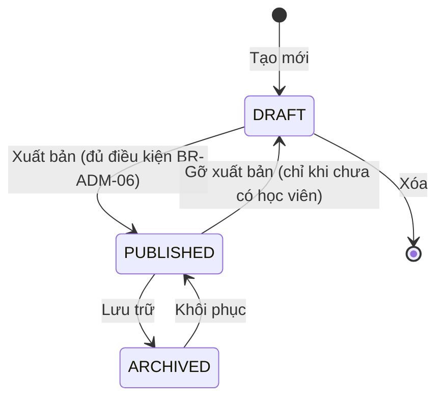

# 06 — Trang quản trị (Admin)

Nguồn: `knowledge_base/trang quản trị.txt`. Toàn bộ chức năng yêu cầu vai trò `ADMIN`, đường dẫn gốc `/admin`, API `/api/admin/**`.

## 1. Danh sách yêu cầu chức năng

| Mã | Chức năng | Ưu tiên |
|----|-----------|---------|
| **Quản lý người dùng** | | |
| FR-ADM-01 | Danh sách người dùng: tìm kiếm, lọc, phân trang | M |
| FR-ADM-02 | Tạo người dùng | M |
| FR-ADM-03 | Xem chi tiết người dùng (hồ sơ + khóa học đã ghi danh) | M |
| FR-ADM-04 | Cập nhật người dùng, gán vai trò | M |
| FR-ADM-05 | Khóa / mở khóa tài khoản | M |
| FR-ADM-06 | Xóa người dùng (xóa mềm) | M |
| **Quản lý loại khóa học (2 cấp)** | | |
| FR-ADM-07 | Xem cây loại khóa học | M |
| FR-ADM-08 | Tạo loại cấp 1 / cấp 2 | M |
| FR-ADM-09 | Sửa, sắp xếp thứ tự, bật/tắt loại khóa học | M |
| FR-ADM-10 | Xóa loại khóa học | M |
| **Quản lý tổ chức đào tạo** | | |
| FR-ADM-11 | CRUD tổ chức đào tạo | M |
| **Quản lý khóa học** | | |
| FR-ADM-12 | Danh sách khóa học: tìm kiếm, lọc, phân trang | M |
| FR-ADM-13 | Tạo / sửa thông tin khóa học | M |
| FR-ADM-14 | Xuất bản / ẩn / lưu trữ khóa học | M |
| FR-ADM-15 | Xóa khóa học | M |
| FR-ADM-16 | Quản lý bài học trong khóa (CRUD, sắp xếp kéo thả) | M |
| FR-ADM-17 | Quản lý quiz của bài học (câu hỏi, đáp án) | M |
| FR-ADM-18 | Xem danh sách học viên & tiến độ của khóa học | S |
| FR-ADM-19 | Xem / tính lại bảng xếp hạng khóa học | S |
| FR-ADM-20 | Kiểm duyệt đánh giá (ẩn/hiện) | S |
| **Khác** | | |
| FR-ADM-21 | Dashboard thống kê cơ bản | S |
| FR-ADM-22 | Nhật ký thao tác quản trị (audit log) | S |
| FR-ADM-23 | Tải lên tệp (ảnh, tài liệu) | M |

## 2. Quản lý người dùng

### FR-ADM-01 — Danh sách

- Cột: ID, họ tên, email, vai trò, trạng thái, ngày tạo, lần đăng nhập gần nhất, thao tác.
- Tìm theo họ tên / email / số điện thoại; lọc theo vai trò, trạng thái, khoảng ngày tạo; sắp xếp theo cột; 20 dòng/trang.
- Xuất danh sách ra CSV (S).

### FR-ADM-02 — Tạo người dùng

- Trường như đăng ký (tài liệu 02) + chọn vai trò + trạng thái.
- Hai cách đặt mật khẩu: (a) Admin nhập mật khẩu tạm; (b) hệ thống gửi email chứa liên kết đặt mật khẩu (hiệu lực 24 giờ). Tài khoản do Admin tạo được coi là đã xác thực email.

### FR-ADM-03 — Chi tiết

- Hồ sơ đầy đủ, danh sách khóa học đã ghi danh kèm tiến độ, tổng điểm, lịch sử đăng nhập gần nhất.

### FR-ADM-04 — Cập nhật

- Sửa thông tin hồ sơ, email (đánh dấu cần xác thực lại), vai trò.
- Nút "Gửi email đặt lại mật khẩu" cho người dùng.

### FR-ADM-05 — Khóa / mở khóa

- Khóa → thu hồi toàn bộ refresh token của người đó (đăng xuất ngay), nhập lý do khóa (lưu audit log).

### FR-ADM-06 — Xóa

- Xóa mềm (`deleted_at`), ẩn danh hóa email (`deleted_<id>@…`) để email có thể đăng ký lại; giữ lại dữ liệu học tập phục vụ thống kê nhưng loại khỏi bảng xếp hạng.

**Quy tắc (BR-ADM-01):** Admin không được tự khóa/xóa/hạ quyền chính mình; không được thao tác khiến hệ thống không còn Admin nào (BR-AUTH-07).

## 3. Quản lý loại khóa học (2 cấp)

### Mô hình

```
Kỹ năng số                 ← cấp 1 (parent_id = NULL)
 ├── Sử dụng máy tính cơ bản   ← cấp 2 (parent_id = Kỹ năng số)
 ├── An toàn thông tin
 └── Dịch vụ công trực tuyến
Ngoại ngữ
 ├── Tiếng Anh giao tiếp
 └── ...
```

### FR-ADM-07 → FR-ADM-10

- Giao diện dạng cây (mở rộng/thu gọn), hiển thị số khóa học trong từng loại.
- Trường: tên (bắt buộc, duy nhất trong cùng cấp cha), slug (tự sinh từ tên không dấu, cho phép sửa, duy nhất), mô tả, biểu tượng/ảnh, thứ tự hiển thị, trạng thái hoạt động, loại cha (rỗng = cấp 1).
- Sắp xếp thứ tự bằng kéo thả trong cùng cấp.

**Quy tắc:**

| Mã | Quy tắc |
|----|---------|
| BR-ADM-02 | Tối đa **2 cấp**: loại cha của một loại phải là loại cấp 1 (có `parent_id = NULL`). |
| BR-ADM-03 | Khóa học chỉ được gắn vào **loại cấp 2**. (Nếu một lĩnh vực cấp 1 không cần chia nhỏ, tạo một loại cấp 2 "Chung".) |
| BR-ADM-04 | Không xóa được loại cấp 1 còn loại con; không xóa được loại cấp 2 còn khóa học → hệ thống báo số lượng và gợi ý chuyển khóa học sang loại khác trước. |
| BR-ADM-05 | Tắt (inactive) loại khóa học: loại đó và các loại con ẩn khỏi bộ lọc công khai; khóa học bên trong vẫn truy cập được qua link nhưng không xuất hiện trong lọc theo lĩnh vực đó. |

## 4. Quản lý tổ chức đào tạo — FR-ADM-11

- Trường: tên (bắt buộc, duy nhất), slug, logo, mô tả, website, email liên hệ, trạng thái hoạt động.
- Không xóa được tổ chức đang có khóa học (chỉ được tắt hoạt động).
- Bổ sung so với knowledge base: cần thực thể này để phục vụ bộ lọc "tổ chức đào tạo" ở trang người dùng.

## 5. Quản lý khóa học

### FR-ADM-12 — Danh sách

- Cột: ảnh bìa, tên, loại (cấp 1 › cấp 2), tổ chức, trình độ, trạng thái xuất bản, trạng thái thời gian (Sắp mở/Đang mở/Đã kết thúc), số bài học, số học viên, ngày cập nhật.
- Lọc theo mọi thuộc tính trên + từ khóa.

### FR-ADM-13 — Tạo / sửa khóa học

| Trường | Bắt buộc | Ghi chú |
|--------|----------|---------|
| Tên khóa học | Có | 5–200 ký tự |
| Slug | Có | Tự sinh, duy nhất |
| Loại khóa học (cấp 2) | Có | BR-ADM-03 |
| Tổ chức đào tạo | Có | |
| Trình độ | Có | `BASIC` / `INTERMEDIATE` / `ADVANCED` |
| Mô tả ngắn | Có | ≤ 300 ký tự, hiển thị trên thẻ |
| Mô tả chi tiết | Có | Rich text |
| Mục tiêu đầu ra, đối tượng, yêu cầu đầu vào | Không | Rich text / danh sách |
| Ảnh bìa | Có (để xuất bản) | JPG/PNG/WebP ≤ 2MB, tỉ lệ 16:9 |
| Ngày bắt đầu, ngày kết thúc | Không | `end_date` > `start_date` |
| Thời lượng ước tính (phút) | Không | Mặc định = tổng thời lượng các bài |
| Điều kiện chứng nhận | Không | Giai đoạn 2 |
| Khóa học nổi bật | Không | Hiển thị trên trang chủ |

Có nút **"Xem trước"** hiển thị trang chi tiết khóa học như người học sẽ thấy.

### FR-ADM-14 — Vòng đời xuất bản



| Mã | Quy tắc |
|----|---------|
| BR-ADM-06 | Điều kiện xuất bản: có ảnh bìa, có ít nhất 1 bài học đã xuất bản, mọi quiz của các bài đã xuất bản đều có ≥ 1 câu hỏi hợp lệ. |
| BR-ADM-07 | Khóa học đã có học viên ghi danh: không gỡ về `DRAFT` và không xóa được; chỉ có thể `ARCHIVED` (ẩn khỏi tìm kiếm, học viên đã ghi danh vẫn xem lại được). |
| BR-ADM-08 | Khóa học `DRAFT` chưa có học viên được xóa hẳn (kèm bài học, quiz). |

### FR-ADM-16 — Quản lý bài học

- Danh sách bài học của khóa, sắp xếp kéo thả (cập nhật `order_index`).
- Trường: tên bài, nội dung (rich text — chèn ảnh, video nhúng, bảng), đề bài (rich text), tệp đính kèm, thời lượng ước tính (phút), trạng thái xuất bản bài (`is_published`).
- Bài chưa xuất bản không hiển thị với người học và không tính vào tiến độ.
- Cảnh báo khi sắp xếp lại / chèn bài vào khóa học đã có học viên (ảnh hưởng mở khóa — xem BR-LRN-02).
- Xóa bài học đã có người học hoàn thành → chỉ cho phép ẩn (`is_published = false`).

### FR-ADM-17 — Quản lý quiz

- Bật/tắt quiz cho bài học. Cấu hình: tiêu đề, điểm đạt (% — mặc định 70), thời gian giới hạn (phút, rỗng = không giới hạn), số lần làm tối đa (rỗng = không giới hạn), thời gian chờ giữa 2 lần, xáo trộn câu hỏi/đáp án, cho phép xem đáp án sau khi nộp.
- Câu hỏi: nội dung (rich text, cho phép ảnh), loại (`SINGLE_CHOICE` / `MULTIPLE_CHOICE` / `TRUE_FALSE`), điểm (mặc định 1), giải thích, thứ tự.
- Đáp án: 2–8 đáp án/câu; `SINGLE_CHOICE` và `TRUE_FALSE` có đúng 1 đáp án đúng; `MULTIPLE_CHOICE` có ≥ 1 đáp án đúng.
- Nhập câu hỏi hàng loạt từ file Excel/CSV theo mẫu (S).
- Sửa đáp án đúng khi đã có người làm → cảnh báo và gợi ý "Tính lại xếp hạng" (FR-RNK-04).

### FR-ADM-18 — Học viên của khóa học

- Danh sách: họ tên, email, ngày ghi danh, tiến độ %, trạng thái, tổng điểm, hạng; lọc theo trạng thái; xuất CSV.

### FR-ADM-20 — Kiểm duyệt đánh giá

- Danh sách đánh giá toàn hệ thống, lọc theo khóa học / số sao; ẩn hoặc hiện lại đánh giá kèm lý do. Đánh giá bị ẩn không tính vào điểm trung bình.

## 6. Dashboard & audit

### FR-ADM-21 — Dashboard cơ bản

- Thẻ số liệu: tổng người dùng, người dùng mới 7 ngày, tổng khóa học đã xuất bản, tổng lượt ghi danh, lượt hoàn thành khóa học.
- Biểu đồ: người dùng mới / lượt ghi danh theo ngày (30 ngày gần nhất); Top 5 khóa học nhiều học viên.

### FR-ADM-22 — Audit log

- Ghi lại mọi thao tác tạo/sửa/xóa/khóa/xuất bản của Admin: ai, lúc nào, đối tượng, giá trị trước/sau (JSON), IP.
- Trang xem audit log với bộ lọc theo người thao tác, loại đối tượng, khoảng thời gian. Lưu trữ tối thiểu 1 năm.

### FR-ADM-23 — Tải lên tệp

- Ảnh: JPG/PNG/WebP ≤ 2MB; tài liệu: PDF/DOCX/XLSX/PPTX ≤ 20MB; video MP4 ≤ 200MB (khuyến nghị nhúng YouTube).
- Kiểm tra định dạng bằng nội dung tệp (magic bytes), không chỉ đuôi tệp; tên tệp lưu được sinh ngẫu nhiên.

## 7. Màn hình quản trị

| Mã | Màn hình | Đường dẫn |
|----|----------|-----------|
| SCR-ADM-01 | Dashboard | `/admin` |
| SCR-ADM-02 | Danh sách / chi tiết / form người dùng | `/admin/nguoi-dung`, `/admin/nguoi-dung/:id` |
| SCR-ADM-03 | Cây loại khóa học | `/admin/loai-khoa-hoc` |
| SCR-ADM-04 | Tổ chức đào tạo | `/admin/to-chuc` |
| SCR-ADM-05 | Danh sách khóa học | `/admin/khoa-hoc` |
| SCR-ADM-06 | Form khóa học (tab: Thông tin · Bài học · Học viên · Xếp hạng) | `/admin/khoa-hoc/:id` |
| SCR-ADM-07 | Form bài học + quiz builder | `/admin/khoa-hoc/:id/bai-hoc/:lessonId` |
| SCR-ADM-08 | Kiểm duyệt đánh giá | `/admin/danh-gia` |
| SCR-ADM-09 | Audit log | `/admin/nhat-ky` |

Bố cục chung: sidebar trái (menu chức năng), header (tên admin, đăng xuất), vùng nội dung có breadcrumb; mọi thao tác xóa/khóa đều có hộp thoại xác nhận; thông báo kết quả dạng toast.
