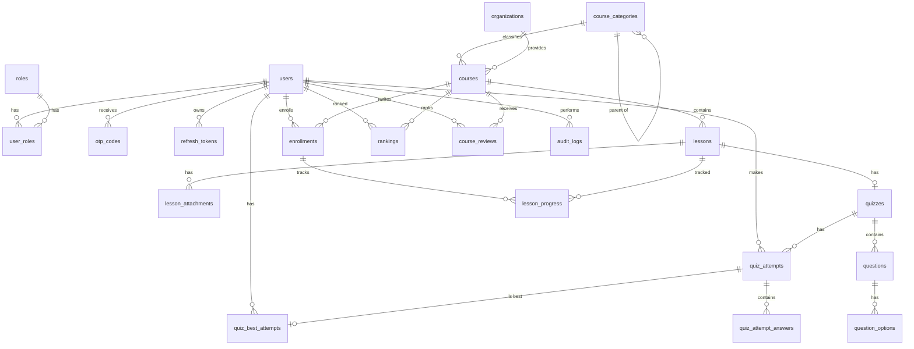

# 07 — Thiết kế cơ sở dữ liệu

Nguồn: `knowledge_base/Thiết kế DB.txt` (người dùng, role, loại khóa học cấp 1/cấp 2, khóa học, ranking, bài học), mở rộng thêm các bảng cần thiết cho nghiệp vụ ở tài liệu 02–06.

> **Cập nhật:** CSDL đã chốt là **Microsoft SQL Server**. Tài liệu này giữ vai trò **thiết kế logic** (ban đầu viết cho PostgreSQL). Thiết kế vật lý chính thức — kiểu dữ liệu, script T-SQL, chỉ mục, sơ đồ ERD Mermaid — nằm tại [`docs/design-db`](../design-db/README.md); các khác biệt được liệt kê ở mục 4 của README đó. Khi có mâu thuẫn, `docs/design-db` được ưu tiên.

CSDL ban đầu: PostgreSQL 16. Quản lý schema bằng Flyway (`backend/src/main/resources/db/migration`).

## 1. Quy ước chung

- Tên bảng: `snake_case`, số nhiều (`users`, `courses`).
- Khóa chính: `id BIGINT GENERATED ALWAYS AS IDENTITY`.
- Mọi bảng nghiệp vụ có `created_at`, `updated_at` (`TIMESTAMPTZ`, mặc định `now()`); bảng cần xóa mềm có `deleted_at`.
- Enum lưu dạng `VARCHAR` + `CHECK` constraint (dễ mở rộng hơn enum type của PostgreSQL).
- Thời gian lưu UTC, hiển thị theo múi giờ `Asia/Ho_Chi_Minh`.
- Extension cần bật: `unaccent`, `pg_trgm`.

## 2. Sơ đồ quan hệ (ERD)



## 3. Chi tiết bảng

### 3.1 Người dùng & xác thực

**`users`** — người dùng (knowledge base: "tên, năm sinh, quê, nơi công tác, ...")

| Cột | Kiểu | Ràng buộc | Mô tả |
|-----|------|-----------|-------|
| id | BIGINT | PK | |
| email | VARCHAR(255) | NOT NULL | Lưu chữ thường; UNIQUE (partial, `WHERE deleted_at IS NULL`) |
| password_hash | VARCHAR(100) | NOT NULL | BCrypt |
| full_name | VARCHAR(100) | NOT NULL | Họ và tên |
| birth_year | SMALLINT | NULL, CHECK 1900..năm hiện tại | Năm sinh |
| hometown | VARCHAR(255) | NULL | Quê quán |
| workplace | VARCHAR(255) | NULL | Nơi công tác |
| phone | VARCHAR(20) | NULL | |
| avatar_url | VARCHAR(500) | NULL | |
| status | VARCHAR(30) | NOT NULL, CHECK IN (`PENDING_VERIFICATION`,`ACTIVE`,`LOCKED`) | |
| lock_reason | VARCHAR(500) | NULL | |
| email_verified_at | TIMESTAMPTZ | NULL | |
| failed_login_count | SMALLINT | NOT NULL DEFAULT 0 | BR-AUTH-05 |
| locked_until | TIMESTAMPTZ | NULL | Khóa tạm do sai mật khẩu |
| last_login_at | TIMESTAMPTZ | NULL | |
| show_on_leaderboard | BOOLEAN | NOT NULL DEFAULT TRUE | FR-RNK-01 |
| privacy_consent_at | TIMESTAMPTZ | NOT NULL | Thời điểm đồng ý chính sách dữ liệu cá nhân (NFR-PRV-01) |
| created_at, updated_at, deleted_at | TIMESTAMPTZ | | |

**`roles`** — vai trò (knowledge base: "Admin, User")

| Cột | Kiểu | Ràng buộc |
|-----|------|-----------|
| id | SMALLINT | PK |
| code | VARCHAR(30) | UNIQUE — `ADMIN`, `USER` (seed sẵn) |
| name | VARCHAR(100) | Tên hiển thị |

**`user_roles`** — `user_id` FK → users, `role_id` FK → roles, PK (`user_id`, `role_id`).

**`otp_codes`**

| Cột | Kiểu | Ràng buộc / mô tả |
|-----|------|-------------------|
| id | BIGINT | PK |
| user_id | BIGINT | FK → users |
| purpose | VARCHAR(30) | `REGISTER`, `RESET_PASSWORD` |
| code_hash | VARCHAR(100) | Hash của mã OTP |
| expires_at | TIMESTAMPTZ | now + 5 phút |
| failed_attempts | SMALLINT | DEFAULT 0, tối đa 5 |
| consumed_at | TIMESTAMPTZ | NULL = chưa dùng |
| invalidated_at | TIMESTAMPTZ | Bị vô hiệu do gửi mã mới / sai quá số lần |
| created_at | TIMESTAMPTZ | |

Chỉ mục: (`user_id`, `purpose`, `created_at` DESC).

**`password_reset_tokens`** — `id`, `user_id`, `token_hash`, `expires_at` (10 phút; 24 giờ nếu do Admin gửi), `used_at`, `created_at`.

**`refresh_tokens`** — `id`, `user_id`, `token_hash` (UNIQUE), `expires_at`, `revoked_at`, `replaced_by_id` (FK tự tham chiếu, phục vụ phát hiện tái sử dụng), `user_agent`, `ip_address`, `created_at`.

### 3.2 Danh mục

**`course_categories`** — loại khóa học cấp 1 & cấp 2 (tự tham chiếu)

| Cột | Kiểu | Ràng buộc / mô tả |
|-----|------|-------------------|
| id | BIGINT | PK |
| parent_id | BIGINT | FK → course_categories, NULL = cấp 1 |
| name | VARCHAR(150) | NOT NULL; UNIQUE (`parent_id`, `name`) |
| slug | VARCHAR(170) | UNIQUE |
| description | TEXT | |
| icon_url | VARCHAR(500) | |
| sort_order | INT | DEFAULT 0 |
| is_active | BOOLEAN | DEFAULT TRUE |
| created_at, updated_at | TIMESTAMPTZ | |

Ràng buộc 2 cấp (BR-ADM-02) kiểm tra ở tầng service + trigger: nếu `parent_id` khác NULL thì bản ghi cha phải có `parent_id IS NULL`.

**`organizations`** — tổ chức đào tạo

| Cột | Kiểu | Ghi chú |
|-----|------|---------|
| id | BIGINT | PK |
| name | VARCHAR(200) | UNIQUE |
| slug | VARCHAR(220) | UNIQUE |
| logo_url, website | VARCHAR(500) | |
| contact_email | VARCHAR(255) | |
| description | TEXT | |
| is_active | BOOLEAN | DEFAULT TRUE |
| created_at, updated_at | TIMESTAMPTZ | |

### 3.3 Khóa học & nội dung

**`courses`**

| Cột | Kiểu | Ràng buộc / mô tả |
|-----|------|-------------------|
| id | BIGINT | PK |
| category_id | BIGINT | FK → course_categories (phải là cấp 2) |
| organization_id | BIGINT | FK → organizations |
| title | VARCHAR(200) | NOT NULL |
| slug | VARCHAR(220) | UNIQUE |
| short_description | VARCHAR(300) | |
| description | TEXT | HTML đã sanitize |
| outcomes, target_audience, prerequisites | TEXT | |
| thumbnail_url | VARCHAR(500) | |
| level | VARCHAR(20) | CHECK IN (`BASIC`,`INTERMEDIATE`,`ADVANCED`) |
| publish_status | VARCHAR(20) | CHECK IN (`DRAFT`,`PUBLISHED`,`ARCHIVED`) |
| start_date, end_date | TIMESTAMPTZ | NULL; CHECK `end_date > start_date` |
| learning_duration_days | INT | NOT NULL DEFAULT 21, CHECK 1..365 — thời hạn học của mỗi lượt ghi danh (BR-LRN-09) |
| estimated_minutes | INT | |
| is_featured | BOOLEAN | DEFAULT FALSE |
| certificate_criteria | JSONB | Giai đoạn 2 |
| published_lesson_count | INT | Cột tổng hợp |
| enrollment_count | INT | Cột tổng hợp (BR-CRS-05) |
| rating_avg | NUMERIC(3,2) | Cột tổng hợp |
| rating_count | INT | Cột tổng hợp |
| published_at | TIMESTAMPTZ | |
| created_by, updated_by | BIGINT | FK → users |
| created_at, updated_at | TIMESTAMPTZ | |

Chỉ mục:
- `GIN (unaccent_immutable(lower(title || ' ' || coalesce(short_description,''))) gin_trgm_ops)` cho tìm kiếm không dấu.
- (`publish_status`, `category_id`), (`publish_status`, `organization_id`), (`publish_status`, `level`), (`start_date`, `end_date`).

**`lessons`** — bài học

| Cột | Kiểu | Ràng buộc / mô tả |
|-----|------|-------------------|
| id | BIGINT | PK |
| course_id | BIGINT | FK → courses ON DELETE CASCADE |
| title | VARCHAR(200) | NOT NULL |
| order_index | INT | NOT NULL; UNIQUE (`course_id`, `order_index`) DEFERRABLE |
| content | TEXT | Nội dung lý thuyết (HTML) |
| video_url | VARCHAR(500) | |
| assignment | TEXT | Đề bài (HTML) |
| estimated_minutes | INT | |
| is_published | BOOLEAN | DEFAULT FALSE |
| created_at, updated_at | TIMESTAMPTZ | |

**`lesson_attachments`** — `id`, `lesson_id` FK, `file_name`, `file_url`, `content_type`, `size_bytes`, `created_at`.

**`quizzes`** — 1 quiz / bài học

| Cột | Kiểu | Ràng buộc / mô tả |
|-----|------|-------------------|
| id | BIGINT | PK |
| lesson_id | BIGINT | FK → lessons, UNIQUE |
| title | VARCHAR(200) | |
| pass_score_percent | SMALLINT | DEFAULT 70, CHECK 0..100 |
| time_limit_seconds | INT | NULL = không giới hạn |
| max_attempts | INT | NULL = không giới hạn |
| retry_cooldown_seconds | INT | DEFAULT 0 |
| shuffle_questions, shuffle_options | BOOLEAN | DEFAULT FALSE |
| show_answers_after_submit | BOOLEAN | DEFAULT TRUE |
| created_at, updated_at | TIMESTAMPTZ | |

**`questions`** — `id`, `quiz_id` FK ON DELETE CASCADE, `content` TEXT, `type` (`SINGLE_CHOICE`/`MULTIPLE_CHOICE`/`TRUE_FALSE`), `points` NUMERIC(5,2) DEFAULT 1, `explanation` TEXT, `order_index` INT, `created_at`, `updated_at`.

**`question_options`** — `id`, `question_id` FK ON DELETE CASCADE, `content` TEXT, `is_correct` BOOLEAN, `order_index` INT.

### 3.4 Học tập

**`enrollments`** — ghi danh

| Cột | Kiểu | Ràng buộc / mô tả |
|-----|------|-------------------|
| id | BIGINT | PK |
| user_id | BIGINT | FK → users |
| course_id | BIGINT | FK → courses |
| status | VARCHAR(20) | `IN_PROGRESS`, `COMPLETED`, `CANCELLED`, `EXPIRED` |
| round_no | INT | DEFAULT 1 — lần học thứ mấy, tăng khi học lại sau khi hết hạn |
| progress_percent | SMALLINT | 0..100 |
| completed_lesson_count | INT | DEFAULT 0 |
| last_lesson_id | BIGINT | FK → lessons, NULL |
| enrolled_at | TIMESTAMPTZ | |
| completed_at | TIMESTAMPTZ | |
| cancelled_at | TIMESTAMPTZ | |
| learning_started_at | TIMESTAMPTZ | NOT NULL — mốc bắt đầu tính hạn: lúc ghi danh, hoặc `start_date` nếu khóa "Sắp mở" |
| expires_at | TIMESTAMPTZ | NOT NULL — `learning_started_at + learning_duration_days`, chốt khi ghi danh |
| expired_at | TIMESTAMPTZ | Thời điểm job xử lý hết hạn; bắt buộc khi `EXPIRED` |

UNIQUE (`user_id`, `course_id`). Chỉ mục (`user_id`, `status`); (`expires_at`) `WHERE status IN ('IN_PROGRESS','CANCELLED')` cho job hết hạn.

**`lesson_progress`**

| Cột | Kiểu | Ràng buộc / mô tả |
|-----|------|-------------------|
| id | BIGINT | PK |
| enrollment_id | BIGINT | FK → enrollments ON DELETE CASCADE |
| lesson_id | BIGINT | FK → lessons |
| status | VARCHAR(20) | `IN_PROGRESS`, `COMPLETED` |
| started_at | TIMESTAMPTZ | |
| completed_at | TIMESTAMPTZ | |

UNIQUE (`enrollment_id`, `lesson_id`).

**`quiz_attempts`** — lượt làm quiz

| Cột | Kiểu | Ràng buộc / mô tả |
|-----|------|-------------------|
| id | BIGINT | PK |
| quiz_id | BIGINT | FK → quizzes |
| user_id | BIGINT | FK → users |
| enrollment_id | BIGINT | FK → enrollments |
| status | VARCHAR(20) | `IN_PROGRESS`, `SUBMITTED`, `EXPIRED` |
| question_order | JSONB | Thứ tự câu/đáp án đã xáo cho lượt này |
| started_at | TIMESTAMPTZ | Giờ máy chủ |
| submitted_at | TIMESTAMPTZ | |
| duration_seconds | INT | `submitted_at − started_at` |
| score | NUMERIC(7,2) | |
| max_score | NUMERIC(7,2) | |
| score_percent | NUMERIC(5,2) | |
| passed | BOOLEAN | |
| counts_for_ranking | BOOLEAN | FALSE nếu nộp sau `end_date` khóa học (BR-RNK-03) |

Chỉ mục: (`user_id`, `quiz_id`, `submitted_at` DESC). Partial UNIQUE (`user_id`, `quiz_id`) `WHERE status = 'IN_PROGRESS'` — đảm bảo chỉ 1 lượt đang làm.

**`quiz_attempt_answers`** — `id`, `attempt_id` FK ON DELETE CASCADE, `question_id` FK, `selected_option_ids` BIGINT[], `is_correct` BOOLEAN, `points_awarded` NUMERIC(5,2). UNIQUE (`attempt_id`, `question_id`).

### 3.5 Xếp hạng

**`quiz_best_attempts`** — lượt tốt nhất của mỗi người cho mỗi quiz (BR-RNK-01)

| Cột | Kiểu | Mô tả |
|-----|------|-------|
| user_id | BIGINT | PK phần 1, FK → users |
| quiz_id | BIGINT | PK phần 2, FK → quizzes |
| course_id | BIGINT | FK → courses (phi chuẩn hóa để tổng hợp nhanh) |
| attempt_id | BIGINT | FK → quiz_attempts |
| score | NUMERIC(7,2) | |
| duration_seconds | INT | |
| achieved_at | TIMESTAMPTZ | |

**`rankings`** — knowledge base: "ranking: id người dùng, id khóa học, điểm"

| Cột | Kiểu | Mô tả |
|-----|------|-------|
| user_id | BIGINT | PK phần 1, FK → users |
| course_id | BIGINT | PK phần 2, FK → courses |
| total_score | NUMERIC(9,2) | Σ score lượt tốt nhất |
| total_duration_seconds | INT | Σ thời gian lượt tốt nhất (phá hòa) |
| completed_quiz_count | INT | |
| last_achieved_at | TIMESTAMPTZ | Phá hòa cấp 3 |
| updated_at | TIMESTAMPTZ | |

Chỉ mục: (`course_id`, `total_score` DESC, `total_duration_seconds` ASC, `last_achieved_at` ASC).

Truy vấn bảng xếp hạng mẫu:

```sql
SELECT r.user_id, u.full_name, r.total_score, r.total_duration_seconds,
       RANK() OVER (ORDER BY r.total_score DESC,
                             r.total_duration_seconds ASC,
                             r.last_achieved_at ASC) AS rank_no
FROM rankings r
JOIN users u        ON u.id = r.user_id
JOIN enrollments e  ON e.user_id = r.user_id AND e.course_id = r.course_id
WHERE r.course_id = :courseId
  AND r.total_score > 0
  AND e.status IN ('IN_PROGRESS', 'COMPLETED')
  AND u.status = 'ACTIVE' AND u.deleted_at IS NULL
  AND NOT EXISTS (SELECT 1 FROM user_roles ur JOIN roles ro ON ro.id = ur.role_id
                  WHERE ur.user_id = u.id AND ro.code = 'ADMIN')
ORDER BY rank_no
LIMIT :size OFFSET :offset;
```

### 3.6 Đánh giá, tệp, audit

**`course_reviews`** — `id`, `course_id` FK, `user_id` FK, `rating` SMALLINT CHECK 1..5, `comment` VARCHAR(1000), `is_hidden` BOOLEAN DEFAULT FALSE, `hidden_reason` VARCHAR(500), `created_at`, `updated_at`. UNIQUE (`course_id`, `user_id`).

**`uploaded_files`** — `id`, `storage_key`, `original_name`, `content_type`, `size_bytes`, `uploaded_by` FK → users, `created_at`.

**`audit_logs`** — `id`, `actor_id` FK → users, `action` (`CREATE`/`UPDATE`/`DELETE`/`LOCK`/`UNLOCK`/`PUBLISH`/...), `entity_type`, `entity_id`, `before_data` JSONB, `after_data` JSONB, `ip_address`, `created_at`. Chỉ mục (`entity_type`, `entity_id`), (`actor_id`, `created_at`).

### 3.7 Giai đoạn sau (chưa tạo ở MVP)

| Bảng | Giai đoạn | Mô tả |
|------|-----------|-------|
| `certificates` | 2 | `id`, `user_id`, `course_id`, `code` (UNIQUE, dùng tra cứu), `issued_at`, `pdf_url` |
| `notifications` | 2 | Thông báo in-app |
| `blog_posts`, `blog_categories`, `blog_tags` | 3 | Blog |

## 4. Dữ liệu khởi tạo (seed)

- `roles`: `ADMIN`, `USER`.
- 1 tài khoản Admin ban đầu: email và mật khẩu lấy từ biến môi trường khi khởi chạy lần đầu (không hard-code).
- Môi trường dev/staging: dữ liệu mẫu ~3 loại cấp 1, ~10 loại cấp 2, 5 tổ chức, 20 khóa học, mỗi khóa 5–10 bài kèm quiz.

## 5. Chính sách lưu trữ & sao lưu

- Sao lưu toàn bộ CSDL production hằng ngày (giữ 30 ngày) + WAL archiving để khôi phục theo thời điểm (RPO ≤ 15 phút).
- `otp_codes`, `password_reset_tokens`, `refresh_tokens` hết hạn được dọn dẹp bởi job hằng ngày.
- `audit_logs` giữ tối thiểu 1 năm.
- Lượt ghi danh hết thời hạn học (BR-LRN-10): job 5 phút/lần xóa `lesson_progress`, `quiz_attempts` (kèm câu trả lời), `quiz_best_attempts`, `rankings` của lượt đó, rồi chuyển enrollment sang `EXPIRED`.
