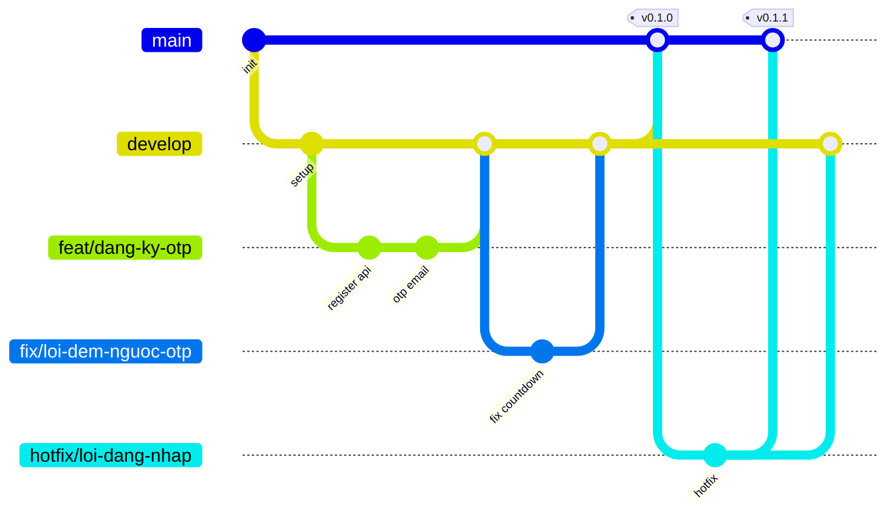

# 10 — Quy trình Git & CI/CD

Nguồn: `knowledge_base/workflow lưu trữ tại GitHub.txt`.

## 1. Mô hình nhánh

| Nhánh | Vai trò | Tạo từ | Merge vào | Deploy |
|-------|---------|--------|-----------|--------|
| `main` | Bản chính thức (production) | — | — | Production |
| `develop` | Nhánh phát triển, tích hợp code của các dev | `main` (1 lần ban đầu) | Đưa sang `main` khi release | Staging |
| `feat/<ten-chuc-nang>` | Phát triển chức năng mới | `develop` | `develop` (qua PR) | — |
| `fix/<ten-chuc-nang>` | Sửa lỗi phát hiện trong quá trình phát triển/kiểm thử | `develop` | `develop` (qua PR) | — |
| `hotfix/<mo-ta>` *(bổ sung)* | Sửa lỗi khẩn cấp trên production | `main` | `main` **và** `develop` | Production |



### 1.1 Quy tắc đặt tên nhánh

- Chữ thường, tiếng Việt **không dấu** hoặc tiếng Anh, các từ nối bằng dấu gạch ngang `-`.
- Có thể kèm mã issue: `feat/12-tim-kiem-khoa-hoc`.
- Ví dụ: `feat/dang-nhap`, `feat/quiz-builder`, `fix/sai-tien-do-hoc`, `hotfix/otp-khong-gui-duoc`.

> Knowledge base ghi `feat/ten_chuc_nang` và `fix/ten-chuc_nang` (lẫn `_` và `-`). Tài liệu này thống nhất dùng `-` cho đồng nhất; nếu nhóm muốn dùng `_`, chỉ cần sửa quy tắc kiểm tra tên nhánh trong CI.

### 1.2 Đưa code từ `develop` lên `main`

Knowledge base đề xuất **cherry-pick** code từ `develop` vào `main`. Để giữ lựa chọn đó nhưng hạn chế rủi ro:

| Cách | Khi nào dùng | Lưu ý |
|------|--------------|-------|
| **Merge `develop` → `main` qua PR release** *(khuyến nghị mặc định)* | Mọi lần phát hành theo sprint, khi toàn bộ `develop` đã qua kiểm thử staging | Lịch sử hai nhánh đồng bộ, không sót commit phụ thuộc |
| **Cherry-pick** từ `develop` vào nhánh `release/<phiên-bản>` rồi PR vào `main` | Chỉ muốn phát hành **một phần** chức năng đã xong, phần khác trên `develop` chưa sẵn sàng | Phải cherry-pick đủ commit phụ thuộc (bao gồm migration Flyway); chạy đầy đủ CI trên nhánh release; ghi danh sách commit trong mô tả PR |

Mỗi lần phát hành lên `main` được gắn tag theo Semantic Versioning: `vMAJOR.MINOR.PATCH` (ví dụ `v1.2.0`) và tạo GitHub Release kèm ghi chú thay đổi.

### 1.3 Bảo vệ nhánh (Branch protection)

| Quy tắc | `main` | `develop` |
|---------|:------:|:---------:|
| Cấm push trực tiếp | ✔ | ✔ |
| Bắt buộc Pull Request | ✔ | ✔ |
| Số người duyệt tối thiểu | 2 (hoặc 1 nếu nhóm < 4 người) | 1 |
| Bắt buộc CI xanh | ✔ | ✔ |
| Nhánh phải cập nhật với nhánh đích trước khi merge | ✔ | ✔ |
| Cấm force push / xóa nhánh | ✔ | ✔ |
| Kiểu merge | Merge commit | Squash merge |

## 2. Quy ước commit & Pull Request

### 2.1 Commit message — Conventional Commits

```
<type>(<scope>): <mô tả ngắn>

[nội dung chi tiết — tùy chọn]
[Refs: #<issue>]
```

`type`: `feat`, `fix`, `refactor`, `test`, `docs`, `chore`, `ci`, `perf`, `style`.
Ví dụ: `feat(auth): gửi OTP xác thực email khi đăng ký`, `fix(learning): không mở khóa bài sau khi quiz đạt`.

### 2.2 Pull Request

- Tiêu đề theo định dạng commit; liên kết issue (`Closes #12`).
- Mẫu mô tả (`.github/pull_request_template.md`): Mục đích · Mã yêu cầu SRS liên quan (ví dụ FR-LRN-07) · Thay đổi chính · Ảnh chụp màn hình (nếu có UI) · Cách kiểm thử · Checklist (đã viết test, đã cập nhật tài liệu, đã có migration nếu đổi DB).
- PR nên nhỏ (≤ 400 dòng thay đổi), một PR — một chức năng.

### 2.3 Quản lý công việc

- Dùng GitHub Issues + GitHub Projects (bảng Kanban: Backlog → To do → In progress → In review → Testing → Done).
- Mỗi issue gắn label: `feature`/`bug`/`chore`, module (`auth`, `catalog`, `learning`, `ranking`, `admin`), mức ưu tiên, và mã yêu cầu SRS.

## 3. CI/CD với GitHub Actions

### 3.1 Tổng quan pipeline

```mermaid
flowchart LR
    PR[PR vào develop / main] --> CI
    subgraph CI[CI - ci.yml]
        A[Kiểm tra tên nhánh<br/>& commit] --> B[Lint & format]
        B --> C[Unit test + coverage]
        C --> D[Integration test<br/>Testcontainers]
        D --> E[Build BE + FE]
        E --> F[Quét bảo mật<br/>dependency + gitleaks]
    end
    CI -->|merge vào develop| S[deploy-staging.yml<br/>build image → GHCR → deploy Staging<br/>→ smoke test + E2E]
    CI -->|merge vào main + tag| P[deploy-prod.yml<br/>phê duyệt thủ công → deploy Production<br/>→ smoke test]
```



### 3.2 Workflow chi tiết

| Workflow | Kích hoạt | Các bước |
|----------|-----------|----------|
| `ci.yml` | `pull_request` vào `develop`, `main` | Kiểm tra tên nhánh theo mục 1.1 · Backend: `mvn verify` (Checkstyle, JUnit, Testcontainers SQL Server, JaCoCo ≥ 70%) · Frontend: `npm ci`, `npm run lint`, `npm run test`, `npm run build` · Quét phụ thuộc, gitleaks · Đăng kết quả coverage lên PR |
| `deploy-staging.yml` | `push` vào `develop` | Build Docker image BE/FE, gắn tag `sha` → đẩy lên GHCR → SSH/Deploy lên server staging (`docker compose pull && up -d`) → Flyway migrate tự động khi khởi động → smoke test `/actuator/health` → chạy Playwright E2E trên staging |
| `deploy-prod.yml` | `push` tag `v*.*.*` trên `main` | Dùng GitHub Environment `production` (bắt buộc người phê duyệt) → build/pull image theo tag → sao lưu CSDL trước deploy → deploy → smoke test → tự rollback về image trước nếu smoke test lỗi → thông báo kết quả (email/Slack/Teams) |
| `codeql.yml` *(tùy chọn)* | Hằng tuần + PR vào `main` | Phân tích bảo mật mã nguồn |
| Dependabot | Hằng tuần | Mở PR cập nhật thư viện vào `develop` |

### 3.3 Bí mật & môi trường

| GitHub Environment | Secrets tiêu biểu |
|--------------------|-------------------|
| `staging` | `STAGING_SSH_HOST`, `STAGING_SSH_KEY`, `DB_PASSWORD`, `JWT_SECRET`, `SMTP_*`, `S3_*` |
| `production` | Tương tự, giá trị riêng; bật **Required reviewers** |

### 3.4 Rollback

- Mỗi bản deploy dùng image gắn tag cố định (không dùng `latest`).
- Rollback = deploy lại tag trước đó (`workflow_dispatch` với tham số `version`).
- Migration CSDL phải tương thích ngược ít nhất 1 phiên bản (ví dụ: thêm cột trước, xóa cột ở bản phát hành sau) để rollback ứng dụng không làm hỏng dữ liệu.

## 4. Định nghĩa "Hoàn thành" (Definition of Done)

Một chức năng được coi là hoàn thành khi:

- [ ] Code đã merge vào `develop`, CI xanh.
- [ ] Đáp ứng tiêu chí chấp nhận trong SRS tương ứng.
- [ ] Có unit test cho quy tắc nghiệp vụ; luồng chính có E2E (nếu thuộc NFR-MNT-02).
- [ ] Đã review bởi ít nhất 1 thành viên khác.
- [ ] Đã kiểm thử trên staging, QA/PO xác nhận.
- [ ] Tài liệu API (OpenAPI) và SRS (nếu có thay đổi nghiệp vụ) đã cập nhật.
