# 11 — Kế hoạch triển khai

## 1. Giả định nguồn lực

| Vai trò | Số lượng | Trách nhiệm chính |
|---------|----------|-------------------|
| Product Owner / BA | 1 | Chốt yêu cầu, trả lời câu hỏi mở, nghiệm thu |
| Backend developer (Java) | 2 | API, CSDL, bảo mật |
| Frontend developer (React) | 2 | Trang người dùng, trang quản trị |
| UI/UX designer | 1 (bán thời gian) | Wireframe, design system |
| QA / Tester | 1 | Test case, kiểm thử thủ công, E2E |
| DevOps | 1 (bán thời gian, có thể kiêm BE) | Server, CI/CD, giám sát |

Sprint dài **2 tuần**. Nếu nguồn lực ít hơn, giữ nguyên thứ tự công việc và kéo dài số sprint tương ứng.

## 2. Lộ trình tổng thể

| Giai đoạn | Thời lượng ước tính | Kết quả |
|-----------|---------------------|---------|
| **Giai đoạn 1 — MVP** | ~13 tuần (Sprint 0 → Sprint 6) | Phát hành `v1.0.0` lên production |
| **Giai đoạn 2 — Mở rộng học tập** | ~6–8 tuần | Chứng nhận, xếp hạng toàn hệ thống, thông báo, đăng nhập Google, dashboard nâng cao |
| **Giai đoạn 3 — Cộng đồng & nội dung** | ~6 tuần | Blog/tin tức, vai trò Giảng viên / Quản lý tổ chức đào tạo |

```mermaid
gantt
    title Lộ trình Giai đoạn 1 (MVP) — tuần tương đối
    dateFormat  X
    axisFormat  T%s
    section Chuẩn bị
    Sprint 0 - Khởi tạo & thiết kế        :s0, 0, 1
    section Phát triển
    Sprint 1 - Xác thực & phân quyền       :s1, 1, 3
    Sprint 2 - Quản trị danh mục & người dùng :s2, 3, 5
    Sprint 3 - Quản trị nội dung & tìm kiếm  :s3, 5, 7
    Sprint 4 - Học tập & Quiz               :s4, 7, 9
    Sprint 5 - Xếp hạng, đánh giá, dashboard :s5, 9, 11
    section Ổn định & phát hành
    Sprint 6 - Kiểm thử, UAT, phát hành      :s6, 11, 13
```

## 3. Chi tiết Giai đoạn 1 (MVP)

### Sprint 0 — Khởi tạo & thiết kế (1 tuần)

**Mục tiêu:** sẵn sàng hạ tầng phát triển, chốt các quyết định còn mở.

- [ ] PO chốt các câu hỏi mở Q-01 → Q-11 ([00-tong-quan.md](00-tong-quan.md)) và cập nhật SRS.
- [ ] Tạo nhánh `develop`, cấu hình branch protection, PR template, labels, GitHub Project ([10](10-quy-trinh-git-cicd.md)).
- [ ] Khởi tạo monorepo `backend/` (Spring Boot), `frontend/` (React + Vite), `deploy/` (Docker Compose: SQL Server, Redis, MinIO, MailHog).
- [ ] Cập nhật `.gitignore` cho Node/IDE/.env.
- [ ] Workflow `ci.yml` chạy lint + test + build (khung rỗng).
- [ ] Flyway `V1__init.sql` với các bảng lõi ([07](07-thiet-ke-csdl.md)).
- [ ] Wireframe các màn hình chính; design system (màu, chữ, nút, form) đáp ứng NFR-UX-01, 02.
- [ ] Chuẩn bị server staging.

**Đầu ra:** Dev chạy được toàn bộ hệ thống bằng `docker compose up`; CI chạy trên mọi PR.

### Sprint 1 — Xác thực & phân quyền (2 tuần)

| Hạng mục | Yêu cầu |
|----------|---------|
| BE: đăng ký, OTP, gửi lại OTP, đăng nhập, refresh, đăng xuất, quên/đặt lại mật khẩu, đổi mật khẩu, hồ sơ | FR-AUTH-01 → 09 |
| BE: Spring Security + JWT + RBAC, rate limit, khóa tạm khi sai mật khẩu | FR-AUTH-10, BR-AUTH-01 → 07 |
| BE: dịch vụ gửi email bất đồng bộ + mẫu email | NFR-REL-06 |
| FE: layout chung (header, footer), các màn hình SCR-AUTH-01 → 05, cơ chế tự làm mới token, route guard | |
| FE: layout trang quản trị (sidebar, header) | |
| CI/CD: `deploy-staging.yml` | |

**Demo cuối sprint:** đăng ký → nhận OTP qua email → đăng nhập → đổi mật khẩu → quên mật khẩu; Admin vào được `/admin`, USER bị chặn.

### Sprint 2 — Quản trị danh mục & người dùng (2 tuần)

| Hạng mục | Yêu cầu |
|----------|---------|
| Quản lý người dùng (CRUD, khóa/mở khóa, gán vai trò) | FR-ADM-01 → 06 |
| Quản lý loại khóa học 2 cấp (cây, kéo thả sắp xếp) | FR-ADM-07 → 10 |
| Quản lý tổ chức đào tạo | FR-ADM-11 |
| Tải lên tệp (S3/MinIO) | FR-ADM-23 |
| Tạo/sửa thông tin khóa học (chưa gồm bài học) | FR-ADM-12, 13 |
| Audit log (ghi nhận) | FR-ADM-22 |

**Demo:** Admin tạo cây lĩnh vực, tổ chức, khóa học nháp có ảnh bìa; quản lý người dùng.

### Sprint 3 — Quản trị nội dung & tìm kiếm khóa học (2 tuần)

| Hạng mục | Yêu cầu |
|----------|---------|
| Quản lý bài học (rich text, đề bài, đính kèm, kéo thả thứ tự) | FR-ADM-16 |
| Quiz builder (cấu hình, câu hỏi, đáp án) | FR-ADM-17 |
| Vòng đời xuất bản khóa học | FR-ADM-14, 15, BR-ADM-06 → 08 |
| API & trang tìm kiếm + bộ lọc kết hợp + sắp xếp + phân trang | FR-CRS-01 → 04 |
| Trang chi tiết khóa học: Giới thiệu, Giáo trình, Chứng nhận (thông tin) | FR-CRS-05, 06, 08 |
| Trang chủ | FR-CRS-10 |

**Demo:** Admin xây dựng khóa học hoàn chỉnh và xuất bản; Khách tìm thấy khóa học bằng từ khóa không dấu và các bộ lọc kết hợp.

### Sprint 4 — Học tập & Quiz (2 tuần)

| Hạng mục | Yêu cầu |
|----------|---------|
| Ghi danh, hủy ghi danh, thanh tiến độ, "Khóa học của tôi" | FR-CRS-09, 11, FR-LRN-08 |
| Trang học, nội dung & đề bài, tiếp tục học | FR-LRN-01 → 03, 09 |
| Làm quiz, chấm điểm, kết quả, làm lại, lịch sử | FR-LRN-04 → 06, 10 |
| Mở khóa tuần tự, hoàn thành bài/khóa học | FR-LRN-07, 11, BR-LRN-01 → 08 |

**Demo:** người học ghi danh → học bài 1 → làm quiz không đạt → làm lại đạt → bài 2 tự mở khóa → tiến độ cập nhật → hoàn thành khóa.

### Sprint 5 — Xếp hạng, đánh giá, dashboard (2 tuần)

| Hạng mục | Yêu cầu |
|----------|---------|
| Tính điểm lượt tốt nhất, bảng `rankings`, bảng xếp hạng & hạng của tôi | FR-RNK-01 → 03, BR-RNK-01 → 03 |
| Admin xem / xuất / tính lại xếp hạng | FR-RNK-04, FR-ADM-19 |
| Đánh giá khóa học & kiểm duyệt | FR-CRS-07, FR-ADM-20 |
| Admin xem học viên của khóa | FR-ADM-18 |
| Dashboard cơ bản, trang xem audit log | FR-ADM-21, 22 |
| Tùy chọn ẩn danh trên bảng xếp hạng | NFR-PRV-04 |

**Demo:** nhiều người học cùng điểm được xếp hạng đúng theo thời gian làm bài; Admin xem dashboard.

### Sprint 6 — Ổn định, UAT, phát hành (2 tuần)

- [ ] Hoàn thiện E2E cho các luồng chính (NFR-MNT-02).
- [ ] Kiểm thử hiệu năng (k6/JMeter) theo NFR-PERF-01 → 03.
- [ ] Kiểm thử bảo mật cơ bản (OWASP ZAP baseline), rà soát NFR-SEC-*.
- [ ] Kiểm tra khả năng truy cập (Lighthouse/axe) theo NFR-UX-01 → 03.
- [ ] Trang Chính sách dữ liệu cá nhân, Điều khoản sử dụng (NFR-PRV-01).
- [ ] UAT với nhóm người dùng thật (bao gồm người lớn tuổi), sửa lỗi.
- [ ] Chuẩn bị production: domain, HTTPS, sao lưu, giám sát, cảnh báo (NFR-REL-*).
- [ ] `deploy-prod.yml`, nhập dữ liệu khóa học thật ban đầu.
- [ ] Phát hành `v1.0.0`; viết hướng dẫn sử dụng cho Admin.

## 4. Giai đoạn 2 & 3 (dự kiến)

| Hạng mục | Giai đoạn | Ghi chú |
|----------|-----------|---------|
| Cấp chứng nhận PDF + trang tra cứu mã | 2 | FR-CRS-08 mở rộng, bảng `certificates` |
| Xếp hạng toàn hệ thống / theo tháng | 2 | FR-RNK-05 |
| Thông báo email & in-app (khóa học mới, nhắc học) | 2 | |
| Đăng nhập Google (và đánh giá VNeID) | 2 | FR-AUTH-11 |
| Dashboard thống kê nâng cao, báo cáo xuất Excel | 2 | |
| Người dùng tự xóa tài khoản, đổi email | 2 | NFR-PRV-03 |
| Blog / tin tức (danh mục, thẻ, bình luận) | 3 | Ý tưởng "(Blog): mở rộng" |
| Vai trò Giảng viên / Quản lý tổ chức đào tạo tự quản lý khóa học | 3 | Q-02 |
| Nộp bài tự luận cho "đề bài" và chấm thủ công | 3 | Q-07 |

## 5. Mốc kiểm soát

| Mốc | Thời điểm (tuần tương đối) | Tiêu chí |
|-----|----------------------------|----------|
| M0 — Chốt yêu cầu | Cuối tuần 1 | Câu hỏi mở được trả lời, SRS v1.0 được duyệt |
| M1 — Xác thực hoạt động trên staging | Cuối tuần 3 | Demo Sprint 1 đạt |
| M2 — Admin xây dựng được khóa học hoàn chỉnh | Cuối tuần 7 | Demo Sprint 3 đạt |
| M3 — Luồng học tập đầu-cuối | Cuối tuần 9 | Demo Sprint 4 đạt |
| M4 — Tính năng MVP hoàn tất (feature freeze) | Cuối tuần 11 | Mọi FR mức M đã xong |
| M5 — Phát hành `v1.0.0` | Cuối tuần 13 | UAT đạt, không còn lỗi mức Critical/High |

## 6. Rủi ro & phương án

| Rủi ro | Mức | Phương án giảm thiểu |
|--------|-----|----------------------|
| Câu hỏi mở chậm được trả lời làm thay đổi thiết kế | Cao | Chốt tại Sprint 0; các phương án mặc định đã được thiết kế để thay đổi ít ảnh hưởng (ví dụ cách chọn lượt tính xếp hạng) |
| Email OTP vào thư rác / không gửi được | Cao | Gửi qua Gmail SMTP bằng Java Mail (miễn phí), dùng tài khoản Gmail riêng cho hệ thống, giám sát tỉ lệ gửi lỗi |
| Vượt giới hạn gửi của Gmail miễn phí (~500 email/ngày) khi lượng đăng ký tăng | Trung bình | Theo dõi số email gửi mỗi ngày, cảnh báo khi đạt 80% giới hạn; nếu thường xuyên vượt thì chuyển sang SMTP khác bằng cấu hình `spring.mail.*`, không phải sửa code |
| Người dùng lớn tuổi khó sử dụng | Trung bình | UAT sớm với người dùng thật từ Sprint 4, tuân thủ NFR-UX |
| Gian lận quiz (tra đáp án qua API, sửa thời gian) | Trung bình | BR-LRN-04, BR-LRN-05: không gửi đáp án trước khi nộp, tính thời gian ở máy chủ |
| Admin sửa nội dung khi đã có học viên làm sai lệch tiến độ/xếp hạng | Trung bình | Cảnh báo khi sửa, chức năng tính lại xếp hạng (FR-RNK-04) |
| Cherry-pick sót commit khi phát hành | Trung bình | Ưu tiên merge `develop → main`; cherry-pick chỉ qua nhánh `release/*` có CI đầy đủ (tài liệu 10) |
| Thiếu nội dung khóa học thật khi ra mắt | Trung bình | Lên kế hoạch nhập liệu song song từ Sprint 4, công cụ nhập câu hỏi từ Excel |
| Quá tải khi có chiến dịch truyền thông lớn | Thấp → Trung bình | Backend stateless, cache Redis, kiểm thử tải ở Sprint 6 |

## 7. Bước tiếp theo ngay

1. PO/chủ dự án rà soát bộ SRS và trả lời các câu hỏi Q-01 → Q-11.
2. Cập nhật SRS lên phiên bản 1.0 theo các quyết định.
3. Tạo issue trên GitHub cho từng mã yêu cầu theo kế hoạch sprint ở mục 3.
4. Bắt đầu Sprint 0.
